# Слой завтрашнего дня: каким должен стать Kubernetes, когда вычисления разойдутся по физике, энергии и юрисдикциям

*Тимур Тукаев, ноябрь 2026*

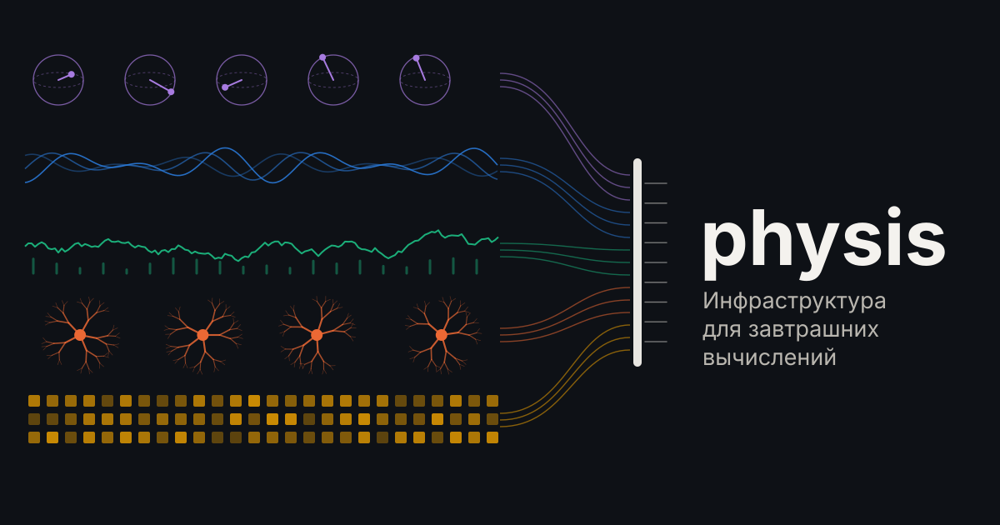

Инфраструктура почти всегда строится под вчерашние задачи. Unix проектировали для машин с разделением времени, TCP/IP — для сети, которая должна пережить потерю узлов, Borg — для одной компании с собственными ЦОДами, где разнородность машин в основном пряталась за единой моделью ресурсов, а Kubernetes унаследовал от Borg почти всё, что в нём устроено глубже API. Каждая из этих систем была блестящим ответом на свои вопросы, и каждую потом десятилетиями растягивали на вопросы, которых их авторы не задавали.

В этой статье мы попробуем пойти в обратную сторону. Сначала разберёмся, какие задачи будут решаться завтра, какой станет физика вычислений, экономика и требования к доверию, и только потом выведем из этого инфраструктурный слой. Этот слой мы проверили на практике, для чего собрали прототип, который выбирает не только место и время для задачи, но и саму физику вычисления (от процессора до квантового компьютера и живых нейронов), и прогнали его на реальных данных энергосистем четырёх европейских стран.

Статья длинная, поэтому вот её план:

1. **Как мы будем вычислять завтра** — десять сил, которые уже видны в измеримых данных: от энергетического потолка до вычислений на нейронах в пробирке.
2. **Экономика послезавтра** — куда идут деньги в ИТ и что это значит для инфраструктуры.
3. **Люди, агенты и доверие** — что прогнозируют Institute for the Future и Future Today Strategy Group и как это ложится на инфраструктуру.
4. **Принципы**, выведенные из этих сил.
5. **Аудит Kubernetes**: что в нём правильно, а что сделано под вчерашний мир, включая подробный разбор сетевого стека.
6. **Дизайн нового слоя**: без понятия узла, с планировщиком физики, сетью по идентичностям и облаком как рынком подложек.
7. **Прототип physis** на восемнадцати физиках, две из них — настоящее железо.
8. **Как мы его проверяли** и что получилось.
9. **Conformance для систем завтрашнего дня** — набор тестов, который может пройти любая реализация.
10. **Ограничения** — где мы могли ошибиться.
11. **Что дальше.**
12. **Как развивать Kubernetes**, чтобы он подошёл и вчерашнему, и завтрашнему миру: что оставить в ядре, что сделать подключаемым.
13. **Cozystack как платформа** для такого слоя.

Код, данные и тесты открыты под лицензией Apache 2.0.

---

## 1. Как мы будем вычислять завтра

Рой Амара, многолетний президент Institute for the Future, сформулировал закон, который носит его имя и гласит, что мы переоцениваем эффект технологии на коротком горизонте и недооцениваем на длинном [iftf2025]. Поэтому дальше речь не о прогнозах, а о тенденциях, у которых уже есть измеримые проявления. Каждую мы потом превратим в требование к инфраструктуре.

### F1. Энергия становится связывающим ограничением

В 2026 году Amazon, Microsoft, Alphabet и Meta вместе тратят на инфраструктуру порядка $720–740 млрд [capex2026]. По прогнозу Gartner, мировые расходы на ИТ в 2026 году составят $6,37 трлн, плюс 14,2% за год [gartner2026]. Но узким местом стали не чипы, а электросеть. Подключение крупного ЦОДа к сети в ряде регионов занимает годы, цена мощности в PJM за два аукциона выросла с $29 до $330 за мегаватт в сутки, газовые турбины ждут годами, а гиперскейлеры подписывают контракты с атомными станциями [power2026].

У энергии есть и обратная сторона, о которой обычно забывают. Вся энергия, потреблённая компьютером, становится теплом, так что вычисление, строго говоря, превращает электричество в тепло и по дороге даёт ответ. Есть физический минимум, предел Ландауэра, то есть энергия стирания одного бита [landauer], и современные чипы тратят на порядки больше. Но в пределе вычисления упираются не в энергию на входе, а в возможность отвести тепло. Отсюда вода для охлаждения, криогеника для квантовых и сверхпроводящих машин и интерес к обратимым вычислениям, которые часть энергии возвращают.

Есть и ограничения, о которых говорят реже. Крупные силовые трансформаторы в 2024 году ждали в среднем около 120 недель против 50 в 2021-м [woodmac-transformers], а газовые турбины ждут годами [power2026]. Гелий нужен криогенике квантовых машин и сверхпроводящей логики. Зато кислород, вопреки интуиции, ограничением не станет, потому что всё мировое сжигание ископаемого топлива вместе с остальными процессами уменьшает количество кислорода в атмосфере примерно на 19 из каждого миллиона молекул кислорода в год, то есть на 0,002% [scripps-o2], а на ЦОДы приходится лишь малая часть этого сжигания.

**Что это значит для инфраструктуры.** Энергия перестаёт быть строкой в бухгалтерии и становится ресурсом, который планируется так же, как сегодня планируются процессорные ядра, а вместе с ней планируются углерод, цена часа и тепло.

### F2. Физика вычислений расходится

Ещё недавно под разнородным железом понимали процессоры и GPU разных вендоров. Сегодня рядом появились машины, которые считают принципиально по-другому:

| Физика | Что это | Где мы сейчас |
|---|---|---|
| **Аналоговые вычисления в памяти** | Матричное умножение токами прямо в ячейках памяти, без перекладывания данных | Чип IBM HERMES на фазово-переходной памяти: 63,1 TOPS при 9,76 TOPS/W, эффективная точность 3–4 бита [legallo2023] |
| **Нейроморфные чипы** | Нет тактовой частоты, вычисление идёт событиями-спайками | Hala Point в Sandia: 1152 чипа Loihi 2, 1,15 млрд нейронов [halapoint]; у первого Loihi — около 20–25 пДж на синаптическую операцию [loihi] |
| **Вероятностные компьютеры на p-битах** | Чип выдаёт выборки из распределения, используя тепловой шум как ресурс | Стохастический магнитный переход — по оценкам, около 2 фДж на случайный бит [singh2024]; первые устройства Extropic у ранних пользователей [extropic] |
| **Машины Изинга** | Задача оптимизации кодируется в физическую систему, и та сама сваливается в минимум энергии | FPGA с симулированной бифуркацией решала MaxCut на 2000 вершинах в 124 раза быстрее оптимизированного отжига [tatsumura2019]; оптические машины работают при комнатной температуре [cim2026] |
| **Обратимые вычисления** | Логика возвращает часть энергии переключения | Тестовый чип Vaire — около 30% экономии энергии на той же задаче [vaire] |
| **Сверхпроводящая логика** | Переключение почти без энергии, но при 4 К | imec обещает ЦОД размером с обувную коробку [imec-sfq]; охлаждение на 4 К стоит не меньше 74 Вт на ватт отведённого тепла по пределу Карно, у лучших установок — меньше 400 Вт/Вт [primavera2021], у обычных установок на циклах Коллинза и Брайтона — около 740 Вт/Вт, у малых криокулеров — 5–7,5 кВт/Вт [cryo4k] |
| **Фотонные вычисления** | Умножение светом | 0,27 пДж на умножение-сложение только на лазер в лабораторном процессоре [photonic2024] |
| **Квантовые процессоры** | Встраиваются в суперкомпьютерные центры под обычным планировщиком | Центр PCSS в Познани под Slurm [pcss-hybrid]; сверхпроводящая установка Google Sycamore с криогеникой потребляла до 26 кВт [arute2019supp] |
| **Живые нейроны** | Культуры человеческих нейронов как вычислитель | Cortical Labs CL1 — нейроны, выращенные из стволовых клеток человека, на кремниевом чипе; продаётся примерно за $35 тысяч, потребляет около 20 Вт, нейроны живут до полугода [cl1power]; органоиды FinalSpark живут около 100 дней [finalspark] |
| **Обучаемая физика и вычисляющие материалы** | Звук, свет, механика обучаются как нейросеть; метаматериал работает как логика | Физические нейросети [mcmahon]; механический метаматериал с реконфигурируемой логикой [metamaterial2026] |

Рядом с экзотикой идёт волна куда более приземлённых архитектур. Они меняют не физику переключения, а сам способ вычисления, то есть то, где оно происходит, как устроены числа и сколько точности на самом деле нужно. Именно они окажутся в ЦОДах в ближайшие годы.

| Архитектура | Что меняется | Что известно |
|---|---|---|
| **Систолические тензорные массивы** | Матричное умножение волной через решётку умножителей, данные переиспользуются без обращений к памяти | TPU v1: 65 536 восьмибитных умножителей, 92 TOPS, 40 Вт под нагрузкой, в 30–80 раз выше TOPS/Вт, чем у GPU и CPU того времени [jouppi2017tpu]; TPU v4 — ещё в 2,7 раза лучше по производительности на ватт [jouppi2023tpuv4] |
| **Dataflow и пространственные процессоры** | Нет кешей и арбитров: компилятор статически раскладывает поток данных по кристаллу, время детерминировано | Groq TSP: около 750 TOPS int8 и 220 МиБ SRAM на кристалле [abts2020tsp]; Cerebras WSE-3 — пластина целиком: 900 тыс. ядер и 44 ГБ SRAM [cerebras2024wse3]; SambaNova SN40L сливает операторы модели в один конвейер [prabhakar2024sn40l] |
| **Вычисления в памяти DRAM** | Вычислители стоят в банках памяти, данные не едут к процессору | Samsung HBM-PIM: 1,2 TFLOPS из банков HBM2 [kwon2021fimdram], энергия на переданный бит ниже в 3,5 раза [lee2021pim]; UPMEM — серийные модули, в среднем в 28–93 раза быстрее CPU на 13 из 16 тестов PrIM [gomezluna2022upmem] |
| **Пониженная и блочная точность** | Точность становится параметром: FP8, а в форматах Microscaling блок из 32 чисел делит один масштаб | FP8 сохраняет качество 16-битного обучения на моделях до 175 млрд параметров [micikevicius2022fp8]; обучение с весами в MXFP4 — лишь небольшая потеря точности [rouhani2023mx]; восьмибитное целочисленное умножение примерно в 18 раз дешевле 32-битного с плавающей точкой [horowitz2014] |
| **Стохастические вычисления** | Число — доля единиц в случайном потоке битов, умножение — один логический элемент | Точность растёт как логарифм длины потока, зато схема крошечная и терпит сбои битов [alaghi2013survey] |
| **Гипермерные вычисления** | Вычисления над случайными векторами в тысячи измерений: связывание, объединение, сравнение | Устойчивы к отказам отдельных битов [kanerva2009hdc]; в памяти на фазовых переходах — более чем в 6 раз меньше энергии, чем в цифровой реализации [karunaratne2020inmemory] |
| **CGRA и FPGA** | Перестраиваемая под задачу сетка вычислителей вместо потока инструкций | Большинство CGRA выполняют больше операций на ватт, чем GPU, некоторые — на два порядка [podobas2020cgra] |

Для слоя управления эта волна важнее экзотики. Здесь компромисс «качество — энергия» становится повседневным. Одна и та же модель в FP4 дешевле, чем в FP8, но чуть менее точна, и решать, хватит ли этого, должна задача, а не программист.

У каждой из этих физик своя скорость, точность, шум, своя калибровка и своя цена операции. Разнородность здесь означает не «разных вендоров одного и того же», а разные способы считать.

Новая физика ломает и привычные допущения эксплуатации. Состояние аналогового массива, обученного метаматериала или живой культуры нельзя «снять снапшотом» и перенести на другую машину, так что миграция сводится к переобучению на новом носителе. Значит, истинное состояние должно жить вне железа, в описании и данных обучения, а железо становится воспроизводимым исполнением. Эксплуатация превращается в уход за организмом, где есть калибровка, переобучение, старение, криогеника, а для органоидов и буквальное кормление. А у живого железа появляется этика. Это первая инфраструктура, где у ресурса могут быть права, поэтому платформе нужны правила использования, а не только RBAC.

**Что это значит для инфраструктуры.** Ресурс нельзя описать ядрами и гигабайтами. Его надо описывать физикой, то есть операцией, скоростью, энергией на операцию, точностью, шумом, окнами калибровки и ёмкостью. И физику планировщик должен выбирать так же, как выбирает место.

### F3. Границы машины растворяются

CXL позволяет объединять память в пулы, и уже предлагают домен памяти на весь ЦОД через оптику; обзор в Nature Reviews Electrical Engineering прямо называет это дизайном «ЦОД как один чип» [cxl-dc]. NVIDIA анонсировала Vera Rubin Ultra с 576 GPU в одной фабрике NVLink [ocp2026], а Oxide проектирует стойку, а не сервер [oxide]. «Узел» как неделимый сервер с процессором, памятью и дисками всё хуже совпадает с тем, как устроено железо.

### F4. Агенты становятся главными пользователями

Агентам выдают песочницы-микроВМ на каждую сессию [microvm2026]. Протоколы платежей между машинами (x402, переданный в Linux Foundation, и AP2, переданный в FIDO) позволяют агенту платить другому агенту по мандату человека [x402, ap2-fido]. Эми Уэбб из Future Today Strategy Group называет это «следующим интернетом», построенным для агентов [ftsg2026]. Главным, кто вызывает API завтрашней инфраструктуры, станет машина, которая делает тысячи вызовов в секунду и упорно ищет обходные пути.

### F5. Доверие перестаёт быть бесплатным

Institute for the Future в прогнозе на 2036 год выделяет три темы о знании и доверии [iftf2036]: «различение», то есть то, что заменит эвристику «видеть — значит верить»; кризис научного знания, когда генеративные системы производят правдоподобные результаты и фальшивые ссылки по запросу; и «четыре культуры ИИ». Годом раньше IFTF отдельно писал о кризисе проверки, что ты человек [iftf2025]. Технический ответ уже строится. Это аттестация железа, вычисления над зашифрованными данными, которые переходят на специализированные ускорители (пока FPGA, ASIC в разработке) [fhe2026], и формальная верификация на Lean в AWS [demoura2026]. Доверие становится не ощущением, а структурой данных, которую можно проверить.

### F6. Вычисления становятся товаром

Цена достижения фиксированного качества ответа языковой модели падает медианно примерно в 50 раз в год, с разбросом от 9 до 900 раз в зависимости от задачи [epoch-prices]. История подсказывает, что общие расходы при этом не упадут, а вырастут. Это парадокс Джевонса [jevons], по которому дешевеющий ресурс потребляют всё больше. Биржи CME, ICE и Nodal готовят фьючерсы на GPU-часы [compute-futures]. Оплата за место в SaaS уступает оплате за результат [outcome-pricing]. EU Data Act с 12 января 2027 года запрещает брать плату за смену облачного провайдера, включая плату за вывод данных при переезде [data-act]. Вычисления тянутся к цене энергии и амортизации, а удерживать клиента начинают цена, качество и доверие, а не привязка к вендору. В Berkeley эту логику довели до архитектуры «sky computing», где пользователь отдаёт задачу брокеру, а тот сам выбирает облако по цене и доступности [skypilot].

### F7. Вычисления уходят туда, где нет постоянной связи

Физический ИИ, роботы и модели мира живут в замкнутом цикле «сбор — обучение — выкладка на край сети — дообучение» [abi-physical]. IFTF называет переход «от больших языковых моделей к большим моделям мира» одной из сил десятилетия [iftf2036]. ЦОДы проектируют даже на орбите. Google в проекте Suncatcher вместе с Planet Labs собирается к началу 2027 года запустить два спутника-прототипа с TPU, а Starcloud уже вывел на орбиту спутник с GPU NVIDIA [suncatcher]. Связь там прерывистая, и для таких сред IETF стандартизировал протокол с промежуточным хранением, Bundle Protocol v7 [rfc9171]. Центр управления, который должен быть доступен всегда, там не работает.

### F8. Системы начинают проектировать машины

В Berkeley цикл «сгенерировать — проверить — улучшить» нашёл для ряда системных задач (планирования между регионами облака, балансировки экспертов в MoE, планирования транзакций) алгоритмы лучше человеческих, которые работают до 5 раз быстрее или обходятся до 50% дешевле [adrs]. Узким местом такого подхода оказывается точный оценщик. Значит, в инфраструктуру нужно встроить симулятор-двойник и спецификации, по которым машина может проверять собственные изменения.

### F9. Состояние важнее вычисления

Durable execution делает состояние программы первичным, а вычисление — восстанавливаемым исполнителем; проект DBOS начинался как исследование «ОС, у которой всё состояние в таблицах базы» [dbos]. Hydro и теорема CALM показывают, какие распределённые программы обходятся без координации [hydro, calm], а local-first и «податливый софт» Ink & Switch возвращают данные владельцу [localfirst, malleable]. Вычислитель становится заменяемым, а ценность переходит в данные и их происхождение.

### F10. Неопределённость становится нормой

Вероятностные чипы выдают выборки, аналоговые — приближённый результат с шумом, квантовые — распределение по выстрелам, модели ИИ — ответ с уверенностью. На смену правильному ответу приходит ответ, который с известной вероятностью достаточно хорош. Системе, которая умеет только «желаемое состояние — три реплики», нечего сказать о таком мире.

### От практичного к безумному

Если разложить всё это по зрелости, получается такая лестница:

| Зрелость | Что | Почему важно для слоя |
|---|---|---|
| **Уже в проде** | Пулы памяти CXL, оптические фабрики, микроВМ для агентов, durable execution, сдвиг задач по углероду | Узел перестаёт быть единицей; работа должна переживать падение исполнителя |
| **Ближайшие годы** | ИИ, проектирующий системы; доказуемый код; языки для облака целиком; брокеры между облаками; намерение вместо команд | Нужны двойники, спецификации, план до исполнения |
| **Другая физика** | Аналоговые, нейроморфные, вероятностные, фотонные, обратимые, сверхпроводящие машины; квантовые процессоры в ЦОДе | Планировщик должен выбирать физику |
| **Безумное, но с деньгами** | ЦОДы на орбите, ДНК-хранение в стойке [dna2026], живые нейроны как вычислитель | Прерывистая связь, ограниченный срок жизни железа, этика ресурса |

---

## 2. Экономика послезавтра

В ИТ сейчас рекордный денежный бум, под которым растёт долг. Выпуск долга ИИ-компаний в 2026 году, по оценке Morgan Stanley, превысит $500 млрд [ai-debt], и Банк Англии предупреждает о несовпадении сроков, потому что жизненный цикл ИИ-чипов короткий и неопределённый, а кредиторы предпочитают давать в долг на более долгие сроки [boe-fsr-2026]. Если выручка не догонит вложения, мир получит то, что уже видел в 2001 году с оптоволокном, когда инвесторы разорялись, а избыточная инфраструктура доставалась следующему поколению по цене лома. Если догонит, вычисления станут коммунальной услугой, дешёвой за единицу и огромной по объёму. Если же связывающим ограничением окажется энергия, вычисления привяжутся к местам, где она есть, и цена будет считаться в джоулях.

При любом из трёх исходов инфраструктуру меняют одни и те же вещи:

1. **Единица ценности смещается** от места в SaaS к действию, результату, токену и в конце концов к джоулю.
2. **Вычисления получают биржевую цену**, а значит, нужны стандарты учёта и доказуемая поставка.
3. **Покупатель — машина**, которая платит за каждый вызов в пределах бюджета и мандата.
4. **Железо живёт экономически недолго, а здания — долго.** В одном пуле окажутся пять поколений ускорителей и экзотика, и выигрывает тот, кто умеет выжимать деньги из старого.
5. **Энергия — главная статья себестоимости и новый источник дохода.** Работу, которую можно отложить, оплачивает сама сеть.
6. **Переезд дешевеет**, и привязка перестаёт быть бизнес-моделью.
7. **Труд дешевеет.** ИИ пишет код и эксплуатирует системы, так что платформа должна управляться агентами.

Отсюда самая контринтуитивная, на наш взгляд, мысль раздела. Главная экономическая возможность ближайших лет состоит не в том, чтобы построить новые мощности, а в том, чтобы дёшево собрать в работающие облака то, что уже построено в пузырь: подержанные GPU, недогруженные ЦОДы, ночную энергию, железо мелких провайдеров. Слой, который превращает этот разнородный парк в суверенное, измеряемое и проверяемое облако, нужен при любом исходе, будь то мягкая посадка или коррекция.

Обратная сторона энергетического счёта складывается из тепла, воды и углерода. Слой должен считать не только джоули на входе, но и то, куда уходит тепло. В Стокгольме ЦОДы уже продают его в городскую сеть отопления [stockholm-data-parks]. Считать нужно и то, сколько воды ушло на охлаждение и сколько CO₂ стоит за этим джоулем в этот час в этом месте. Тогда планировщик решает не «где дешевле электричество», а «где этот джоуль дешевле всего пришёл и полезнее всего ушёл».

Если вычисления становятся товаром, а уход от поставщика бесплатен, значит, все работают на едином интерфейсе, а компании конкурируют тем, как они его упаковывают. Так уже было с электричеством и стандартной розеткой, с S3 API, с OpenAI-совместимыми эндпоинтами инференса. Стандарт не убирает конкуренцию из техники, а сдвигает её вниз, в себестоимость джоуля, и вверх, в продукт поверх стандарта: домен, доверие, удобство, гарантии. Но у модели «единого интерфейса» есть пределы. Стандарт всегда остаётся наименьшим общим знаменателем. Он покрывает то, в чём все согласны, то есть вчерашнее, а всё новое сначала появляется как расширение конкретного вендора. Вендоры возвращают привязку через расширения по старому рецепту «принять, расширить, уничтожить». Так, S3 стандартен, но вокруг него сотни сцепленных с ним сервисов. Привязка уходит из техники в гравитацию данных (петабайты долго везти даже бесплатно), в контракты и скидки за объём, в навыки команды, в интеграцию с идентификацией и аудитом. Тот, кто владеет стандартом, владеет и рынком. Открыв Kubernetes, Google сделал переносимым слой, на котором держалась привязка к лидеру рынка, и это вариант стратегии «сделай товаром то, что дополняет твой продукт» Джоэла Спольски [spolsky].

Главный риск такого мира в том, что интерфейс захватит тот, кто сядет на него сверху и начнёт брать ренту. Поэтому стандарт должен принадлежать нейтральному фонду и проверяться открытым conformance.

Вокруг единого интерфейса получается рынок с четырьмя ролями:

| Роль | Кто | Чем конкурирует |
|---|---|---|
| **Поставщики подложек** | Владельцы железа любой физики, ЦОДов, энергии, свободных мощностей | Себестоимостью джоуля, местом, надёжностью |
| **Поставщики способов** | Модели, солверы, компиляторы «из задачи в физику», алгоритмы | Качеством на джоуль |
| **Продуктовые провайдеры** | Те, кто собирает способы и подложки в результат для клиента: суверенное облако для банка, GPU-облако для SaaS, ИИ для клиники | Доменом, доверием, удобством, ценовой конструкцией, гарантиями — по сути страхованием результата |
| **Потребители** | Люди и всё чаще агенты | Агент сравнивает провайдеров автоматически и мгновенно, поэтому рынок становится очень эффективным |

Чтобы рынок не превратился в магазин приложений с 30% комиссии, нужны четыре условия: стандарт у нейтрального фонда, открытый conformance, переносимые расчёты и репутация, и отсутствие обязательного посредника между потребителем и провайдером.

---

## 3. Люди, агенты и доверие

Institute for the Future выпускает десятилетний прогноз уже несколько десятилетий [iftf2025]. Его выпуск «2036 — What We Choose Next» (октябрь 2026) состоит из десяти прогнозов в трёх блоках [iftf2036]:

- **Доверие и знание:** различение в мире, где видеть больше не значит верить; будущее научного знания; «четыре культуры ИИ» (без ИИ, усиленная ИИ, рядом с ИИ и управляемая ИИ).
- **Куда мигрируют власть и капитал:** «мутные державы», для которых энергия, а не идеология задаёт повестку; «Китай повсюду»; мир после финансиализации; конец старой страховой модели.
- **Ткань повседневной жизни:** одиночество, которое может стать главной социальной силой десятилетия; жизнь в экстремальной жаре, где 1,5 °C — пол, а не потолок; переход от языковых моделей к моделям мира.

Годом раньше, в выпуске 2025–2035 «Strategy in the Age of Chaos», IFTF исходил из того, что операционные системы общества (деньги, знание, климат, образование и даже рождение детей) становятся неузнаваемыми [iftf2025]. Среди его тем есть технологии как новая религия, ИИ как общественное благо по модели коммунальной услуги (Public Option AI), «постэпистемологическая истина», геймблификация рынков, которые появляются и исчезают, как в казино, жизнь в мире, где порог 1,5 °C уже пройден, алгоритмический вред как бизнес-модель, «резервная копия цивилизации на Луне» и кризис проверки, что ты человек. Для инфраструктуры здесь важны две линии: ИИ и вычисления как общественное благо (аргумент за открытый стандартный слой, который не принадлежит одному вендору) и доверие, которое приходится строить заново.

Future Today Strategy Group Эми Уэбб в 2026 году объявила «созидательное разрушение» классического доклада о трендах и представила Convergence Outlook о сходимостях технологий [ftsg2026]. Среди сходимостей есть «живой интеллект» (ИИ, сенсоры и биотех) и «безграничный труд» (агенты, роботы и автоматические фабрики), а отдельно Уэбб говорит о «следующем интернете», который строится для агентов.

Для инфраструктуры из этого следуют два вывода.

**Где кончается человек и начинается агент.** Человек должен задавать то, за что несёт ответственность, то есть ценности, пределы и мандат. Переводить это в параметры должен агент. Человек не должен вводить «точность 0,97 и 4096 выборок»; он отвечает на вопросы «насколько уверенным должен быть ответ, сколько готов заплатить, к какому сроку, чем нельзя рисковать». Остановка для подписи человека нужна по матрице «обратимость × цена × радиус поражения», а не везде. Отсюда дизайн, в котором ядро проектируется для машин, а люди получают виды поверх него. Код при этом исходит из того, что вызывающий может ошибаться или быть злонамеренным. Человек нажимает кнопку раз в минуту, а агент делает тысячу вызовов в секунду и упорно ищет обходные пути. Поэтому предусловия явные, операции транзакционные, бюджеты и инварианты проверяются на сервере, а не в интерфейсе, а у каждого действия есть план до исполнения и оценка стоимости. При этом некоторые действия требуют подписи человека, проверяемой криптографически, а не наличием кнопки в интерфейсе. А «четыре культуры ИИ» превращаются в уровни автономии, то есть в настройку, а не в разные продукты (в прототипе их три; работа совсем без ИИ остаётся вне системы).

**Доверие как структура данных.** У каждого результата должна быть квитанция, где записано, кто попросил и под каким мандатом, что посчитано, на чём, из каких данных, с какой уверенностью и сколько это стоило. Квитанции подписаны и связаны в цепочку, и проверить их может кто угодно без доступа к системе. Тогда прогноз IFTF о «различении» превращается в свойство инфраструктуры, и доверие проверяется, а не оценивается на глаз.

Проверка тоже стоит энергии, поэтому её глубина выбирается по ставкам, от дешёвой к дорогой:

1. **Подписи и происхождение** — для всего.
2. **Аттестация железа** — доказательство, что считало именно заявленное устройство в заявленном месте.
3. **Перепроверка** на другой физике или у другого провайдера.
4. **Статистический сертификат** для вероятностных вычислений, который даёт уверенность, а не «правильно».
5. **Формальное доказательство** — для критичного кода и политик, как у Cedar в AWS [demoura2026].

Квитанция для рядовой задачи и формальное доказательство для платёжного ядра лежат на ещё одной оси той же модели стоимости.

Сами квитанции стоит писать в журнал только на добавление, который проверяется снаружи, по образцу Certificate Transparency [rfc6962, rfc9162] или журнала Rekor из Sigstore [rekor]. Тогда подделать историю задним числом нельзя не только внутри одной цепочки агента, но и во всей системе.

---

## 4. Принципы

Из десяти сил выводятся четырнадцать принципов. Они же стали основой conformance-набора.

| # | Принцип | Из каких сил |
|---|---|---|
| П1 | **Контракт сохраняется, всё под ним заменяемо.** Экосистема API Kubernetes — язык сегодняшнего дня; проигрывают те, кто требует нового языка | F6; история Plan 9 и Lisp-машин |
| П2 | **Запрос — это результат, а не ресурсы.** Качество, срок, бюджет, допустимые места; выбор алгоритма, физики, места и времени — работа системы | F2, F4, F6, F10 |
| П3 | **Физика описывается явно**, и у каждого числа есть происхождение | F2, F3 |
| П4 | **Стоимость — первоклассное поле**: время, энергия, углерод, деньги; видна граница компромиссов | F1, F6 |
| П5 | **Неопределённость — часть контракта.** Качество как вероятность с нижней границей; не обещать неизмеренного; планировать по прогнозу, оценивать по факту | F10, F5 |
| П6 | **Замкнутый цикл.** Запуски учат модели; двойник проверяет политики | F8, F2 |
| П7 | **Нет узлов.** Подложки сами забирают работу; отказ — это незабранная работа | F3, F7 |
| П8 | **Локальная автономия.** Начатое доводится до конца без центра | F7 |
| П9 | **Проверяемость результата.** Подпись, цепочка, проверка без доступа к системе | F5 |
| П10 | **Люди задают пределы, агенты действуют внутри**: подписанный мандат, уровни автономии | F4, F5 |
| П11 | **У данных и вычислений есть место и юрисдикция**; суверенитет — жёсткое ограничение | F5, F6 |
| П12 | **Гибкая работа идёт за чистой и дешёвой энергией**, срочная не задерживается | F1 |
| П13 | **Открытый стандарт**, проверяемый тестами | F6 |
| П14 | **Агент — первый пользователь API**: строгие схемы, план до исполнения, стоимость до запуска | F4 |

---

## 5. Аудит Kubernetes

Kubernetes вырос из Borg [borg], системы одной компании для долгоживущих сервисов и пакетных задач на процессорах. Разнородность машин Borg в основном скрывал за единой моделью ресурсов, и в API она проникала лишь атрибутами машин в ограничениях размещения. Многое в нём верно и останется.

### Что правильно и остаётся

1. **Декларативный API и согласование.** Ресурс описывает намерение, контроллер приводит мир к нему. Этот приём переживёт любую физику.
2. **Расширяемость API**: CRD, агрегация, list/watch, RBAC, admission. Именно поэтому новые сущности ниже добавляются, а не изобретаются заново.
3. **Культура conformance.** Общий набор тестов сделал Kubernetes стандартом, а не продуктом.
4. **Направление DRA.** Ядро Dynamic Resource Allocation, стабильное с версии 1.34, описывает устройства структурированными атрибутами и выбирает их выражениями CEL [dra]. Это первый шаг к описанию физики, хотя пока без стоимости.
5. **Отход от iptables.** Режим nftables в kube-proxy стал стабильным в 1.33 (по умолчанию по-прежнему iptables), а режим IPVS объявлен устаревшим в 1.35 [nftables, kep5495].
6. **Нейтральное управление в CNCF.**

### Что сделано под вчерашний мир

**Узел как единица размещения, идентичности и отказа.** Pod назначается на Node, kubelet — единственный исполнитель, DaemonSet означает «по одному на каждый объект Node». Это ломается в трёх местах. Железо больше не делится на одинаковые серверы (F3). Многие подложки, например квантовый процессор, машина Изинга или аналоговый массив, вообще не компьютеры с ОС (F2). На краю сети и на орбите «узел недоступен» считается нормальным состоянием, а не аварией (F7). Мы разбирали это в проекте kuberoot, где попытка склеить несколько плат Raspberry Pi в один Node ломается о DaemonSet, потому что каждый агент на «узле» достаётся только одной машине из нескольких.

**Привязка к Linux — это привязка узла, а не Kubernetes.** API, apiserver, etcd, контроллеры и планировщик от Linux не зависят, и проект kcp [kcp] давно показал, что API Kubernetes живёт и вовсе без узлов. Агент узла, kubelet, к ОС привязан, но не жёстко. Есть Windows-узлы, а virtual-kubelet [virtual-kubelet] позволяет выдать за «узел» что угодно, от serverless-облака до чужого API. По-настоящему насквозь линуксовой остаётся только единица работы, контейнер. Поэтому вопрос «отвязать Kubernetes от Linux или написать новую ОС» неверно поставлен. Одна ОС, которая «единообразно работает с разной физикой», получится наименьшим общим знаменателем и убьёт то, ради чего эта физика нужна, потому что квантовый процессор, машина Изинга и живая культура — не компьютеры с ОС, а устройства со своим управляющим стеком. У NVIDIA GPU унифицировал не Linux, а драйверы и CUDA поверх ядра. Унифицировать надо **контракт агента подложки**, который охватывает жизненный цикл, здоровье и калибровку, учёт и аттестацию. Для классической части, обслуживающей устройства, хватит минимальной ОС, заточенной под одну роль, вроде Talos [talos] или Hubris у Oxide [hubris].

**Контейнер как единица работы.** Это Linux-процесс. Для CPU это правильно, а для подложки, где единицей работы служит квантовая схема, постановка QUBO или набор весов для кроссбара, неправильно. Есть переносимый формат процесса (OCI), но нет переносимого формата задачи. Нужен «OCI для физики», то есть переносимая постановка задачи плюс варианты, скомпилированные под конкретную физику. Контейнер остаётся одной из форм, пригодной для классической части.

**Модель ресурсов: ядра и байты.** requests и limits задаются в cpu и memory, а расширенные ресурсы считаются целыми счётчиками. Нет энергии, точности, качества, цены.

**Планировщик знает только «куда».** Он не знает времени и не может отложить работу на чистый или дешёвый час. Нет выбора алгоритма и физики. Нет целевой функции по энергии, углероду и деньгам. Срок задаётся как `activeDeadlineSeconds` у Job, после которого работу убивают, а не как цель, под которую её размещают.

**Желаемое состояние — детерминированное число.** «Три реплики» хороши как цель для сервиса и плохи для вероятностного результата.

**Центральный etcd.** Kubernetes рассчитан на кластеры не больше 5000 узлов, 150 000 подов, 300 000 контейнеров и 110 подов на узел [k8s-large]; всё состояние кластера при этом лежит в одном etcd, и потеря его кворума останавливает управление всем кластером.

**Нет проверяемых результатов.** Аудит-лог фиксирует вызовы API, но не то, что было вычислено, на чём и сколько это стоило.

**Конфигурация для людей.** YAML и шаблоны Helm пишут люди, а агенту нужны типизированные намерения, план до применения и бюджеты на стороне сервера.

**Экономика невидима.** Квоты считают объекты и ядра, но не джоули и деньги.

### Сетевой стек подробно

Модель сети Kubernetes требует, чтобы у каждого пода был свой IP-адрес, а поды на разных узлах связывались без NAT [k8s-net]. Реализацию сети отдают CNI-плагинам, а сервисы обслуживает kube-proxy или его заменители на eBPF. Для одного ЦОДа это было элегантное решение. Посмотрим, что из него следует для завтра.

| Свойство | Почему было правильно | Почему мешает завтра |
|---|---|---|
| Плоская адресуемая L3-сеть | Один ЦОД, доверенная сеть, простота для приложений | Не переносится на несколько площадок, владельцев, юрисдикций и прерывистые каналы; мультикластерность приходится достраивать |
| Идентичность — это IP-адрес | Совместимость со старым софтом | Адрес эфемерен, а политика, аудит и квитанции должны говорить об идентичности нагрузки |
| Сервис — виртуальный IP плюс правила на каждом узле | Прозрачно для клиентов | Состояние растёт с числом сервисов и конечных точек на каждом узле; для iptables пришлось сделать замену на nftables, IPVS объявлен устаревшим |
| Обнаружение через DNS | Стандарт | Кэширование и TTL плохо сочетаются с нагрузками, живущими секунды |
| NetworkPolicy по IP и меткам на L3/L4 | Просто | Нет взаимной аутентификации, политики «по назначению данных» и юрисдикции |
| TCP как основной транспорт | Универсальность | Для RPC внутри ЦОДа TCP проигрывает специализированным протоколам; Аустерхаут показывает, что его проблемы фундаментальны и взаимосвязаны, а Homa — что транспорт без них возможен [homa] |
| Перенос данных невидим планировщику | Планировщик думает о процессорах | Перенос стоит энергии и времени и может быть запрещён суверенитетом. По оценке Аслана и соавторов, передача данных по магистральным и фиксированным сетям доступа стоила 0,06 кВт·ч на гигабайт в 2015 году и дешевела вдвое примерно каждые два года [aslan2018] |
| Связь есть всегда | Один ЦОД | Край сети и орбита живут с разрывами; для них есть хранение с пересылкой (Bundle Protocol v7) [rfc9171] |

### Итог аудита

| Слой Kubernetes | Решение | Почему |
|---|---|---|
| Машинерия API (apiserver, CRD, watch, RBAC, admission) | **Оставить** | П1 |
| etcd как единственное хранилище | **Переписать** в иерархию: локальное состояние агента, региональное и глобальное только для денег, прав и аудита | П8, F7 |
| Node и kubelet | **Убрать из ядра**, совместимость через агента «процессы Linux» | П7, F2, F3 |
| Pod и контейнер | **Оставить как один из видов работы** | П1, П2 |
| Модель ресурсов cpu/memory | **Заменить** описанием физики и стоимости, DRA — мост | П3, П4 |
| Планировщик | **Переписать** в оптимизатор по алгоритму, физике, месту и времени | П2, П4, П12 |
| Сеть (плоская L3, VIP, IP-политики) | **Переписать** на адресацию по идентичности и связи как объекты с ценой | П11, F5, F7 |
| Аудит API | **Дополнить** квитанциями результатов | П9 |
| Квоты | **Заменить** бюджетами в джоулях, деньгах и граммах CO₂ под мандатом | П10, П4 |
| Conformance | **Оставить приём, расширить предмет** | П13 |

---

## 6. Дизайн нового слоя

### Объекты

| Объект | Что описывает | Чем заменяет Kubernetes |
|---|---|---|
| `Substrate` | Подложку: физику, модель (скорость, энергия, точность, калибровка, ёмкость), зону, оператора и юрисдикцию, живость агента | `Node`; `ResourceSlice` из DRA — частный случай без стоимости |
| `Link` | Связь: задержку, пропускную способность, джоули на байт, юрисдикции, через которые идёт путь (окна доступности — в дизайне) | Нет аналога; реализован в прототипе |
| `Problem` | Работу как результат: класс, экземпляр по ссылке (хэш содержимого попадает в квитанцию), качество и уверенность, срок, бюджет, политику, гибкость, допустимые зоны и юрисдикции, место данных | Дополняет `Pod` и `Job` |
| План в статусе `Problem` | Выбранный способ, прогнозы, граница компромиссов, физики, на которых задача выполнима, причины отказов | Нет аналога |
| Заявка (`claimedBy`) | Подложка забрала работу | Привязку пода к узлу |
| `Receipt` | Подписанную запись результата в цепочке | Нет аналога |
| `Mandate` | Подписанное человеком делегирование: пространство имён, бюджет на день, зоны, срок, уровень автономии | Квоты |

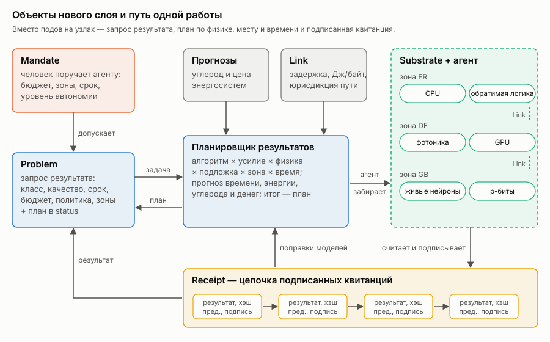

### Жизненный цикл работы

1. Человек или агент создаёт `Problem`.
2. Проверяется мандат, причём подпись должна принадлежать зарегистрированному человеку, а срок действия включать текущий момент.
3. Планировщик перебирает варианты по алгоритму, усилию, физике, подложке и времени начала. Для каждого он предсказывает время, энергию, углерод и деньги, отбрасывает варианты, нарушающие ограничения, выбирает по политике и записывает план вместе с границей компромиссов. Если мандат требует одобрения, план ждёт человека.
4. Агент подложки видит план со своим именем, дожидается времени начала и забирает работу оптимистичной записью с проверкой версии объекта, так что из двух агентов, претендующих на одну работу, успевает только один.
5. Агент считает, подписывает квитанцию и записывает результат. Если центр недоступен, квитанция ждёт в локальной очереди на диске.
6. Квитанция обновляет распределения качества и поправки моделей.
7. Если агент замолчал раньше, чем забрал работу, она возвращается в пул и планируется заново.

### Планирование

Задача описывается как намерение, а ниже живёт многоуровневое представление по типу MLIR [mlir]: задача (оптимизация, вывод, моделирование) → алгоритмы (точный, отжиг, семплирование, приближённый вывод) → физика → конкретные устройства и маршруты данных. Главное здесь в том, что **модель вычисления выбирает планировщик, а не программист**. Одну и ту же оптимизацию можно решить точно на CPU за час, приближённо на машине Изинга за секунду или семплированием на p-битах, и у каждого способа своя кривая «качество — энергия — время». На разнородном графе с плавающими ценами такой выбор оказывается NP-трудной задачей, и точно её никто решать не будет. Рабочий путь состоит в эвристиках, которые генерирует и отбирает ИИ и которые проверяются на симуляторе или цифровом двойнике. Именно так устроен подход ADRS [adrs].

Пространство решений — алгоритм × усилие × физика × подложка × зона × время начала. В модели стоимости число операций (для отжига и классификатора оно известно точно ещё до запуска) превращается во время и энергию по модели подложки, затем умножается на поправки, выученные по квитанциям, и на коэффициент энергоэффективности площадки (PUE; в прототипе это одна константа 1,2 для всех площадок). К этому прибавляется энергия переноса данных по связи. Углерод считается по прогнозу интенсивности сети на окно исполнения, деньги — по цене этого часа.

Качество определяется как нижняя граница вероятности достичь цели по наблюдённым запускам (интервал Уилсона). Если наблюдений нет, вариант не предлагается. Ограничениями служат срок, бюджет, зоны, юрисдикции, мандат, окна калибровки и ёмкость.

Планирование иерархично, и в прототипе работают все три уровня. Глобальный, за минуты и часы, выбирает зону и время старта по прогнозам энергосистем и ценам. Уровень площадки, за секунды, выбирает подложку и момент внутри зоны, где он знает очереди. Локальный уровень живёт в агенте подложки. Если собственные свежие результаты устройства говорят, что запланированное усилие уже не даёт нужного качества с нужной уверенностью, агент поднимает усилие на ступень, подписывает в квитанции то, что запускал на самом деле, и планировщик учится уже на этом. Уровни объявляют о себе через объекты Lease. Это та же иерархия, что и в регулировании энергосистем, и опыт на стенде описан в разделе 8.6.

Нижние уровни этой иерархии должны уметь жить без центра. Здесь полезна идея Дэйва Экли из Университета Нью-Мексико, которую он называет «сначала надёжность» (robust-first computing) [ackley]. Его модель Movable Feast Machine и физические плитки T2 Tiles описывают компьютер из одинаковых модулей без глобальных часов и без главного. Каждая плитка говорит только с соседями, вычисление складывается из популяции маленьких «атомов» с локальными правилами, структуры постоянно сами себя чинят, а корректность достигается «по мере сил». Машину можно наращивать бесконечно, просто добавляя плитки. Экли отказывается от сделки фон Неймана, где идеально детерминированное железо позволяет софту быть хрупким. В чистом виде это философия, а не готовая архитектура, потому что за живучесть платят точностью и отлаживаемостью. Но для края сети, роботов и орбиты, где центр недоступен по определению, локальные правила и соседская координация оказываются правильной формой. Центральные гарантии остаются там, где без них нельзя, то есть в деньгах, правах и аудите.

Часто спрашивают, нужен ли Kubernetes для квантового компьютера. Внутри квантового процессора он не нужен, потому что это одна дорогая машина со своим управляющим стеком. Нерешённая задача лежит вокруг него, и исследователи прямо называют планирование гибридных задач пробелом, которому уделено меньше внимания, чем интеграции программного стека [hpc-qc-sched]. Квантовый процессор — дефицитный ресурс с разделением по времени, у которого дрейфует калибровка. Вариационные алгоритмы гоняют цикл «CPU ↔ QPU» тысячи раз, и их классическую и квантовую части надо ставить вместе с минимальной задержкой. Декодирование коррекции ошибок — классическая нагрузка с микросекундными требованиями рядом с QPU. Например, в PCSS (Познань) это делают через Slurm и CUDA-Q [pcss-hybrid]. В нашей модели QPU становится подложкой с окнами калибровки и стоимостью криогеники, а задача формулируется как результат.

### Агент как первый пользователь

Принцип П14 говорит, что API проектируется прежде всего для машины, а человек получает виды поверх того же состояния. Долгое время в прототипе это означало только то, что задачу можно описать как результат, а не как набор ресурсов, и можно попросить план, ничего не запуская. Этого мало. Агент отличается от человека у API не только тем, что он программа. Он вызывает API тысячи раз там, где человек вызвал бы один. Он повторяет запросы, потому что обрыв по таймауту ничего не говорит ему о том, приняли работу или нет. И он не читает ответ, а ветвится по нему, поэтому ответ, понятный только человеку, для него вообще не ответ.

Отсюда три доработки ядра. Первая обеспечивает повтор без двойного запуска. В спецификации задачи появилось поле `requestID`. Если в пространстве имён уже есть задача с тем же идентификатором, планировщик не планирует копию, а отклоняет её и в поле `status.duplicateOf` называет оригинал. Агент, который не дождался ответа и отправил задачу снова под другим именем, получает ссылку на первую попытку, а не второй счёт за ту же работу. Пробный прогон идентификатор не занимает, потому что ничего не запускает; не занимает его и попытка, отклонённая как дубликат или из-за превышения частоты, иначе повтор после такого отказа упёрся бы в собственную неудачу.

Вторая доработка даёт отказы, по которым можно ветвиться. Раньше причина отказа была только текстом: «зона не разрешена», «превышен бюджет», «не успевает к сроку». Текст остался, но рядом с ним в `status.reasonCodes` теперь стоят устойчивые коды: `ZoneNotAllowed`, `JurisdictionNotAllowed`, `BudgetExceeded`, `QualityUnreachable`, `DeadlineTooShort`, `MandateInvalid`, `Duplicate`, `RateLimited` и ещё несколько. Код не меняется, когда меняется формулировка. Планировщик записывает код каждого отброшенного варианта, а не только тех двадцати, чьи тексты он сохраняет как образец. Агент, получив `BudgetExceeded`, может поднять бюджет или ослабить требование к качеству; получив `DeadlineTooShort`, — сдвинуть срок; получив `QualityUnreachable`, — понять, что дело не в деньгах.

Третья защищает сервер от его собственного главного пользователя. Планировщик пропускает не больше заданного числа новых задач из одного пространства имён в минуту, по умолчанию шестьдесят; лишние отклоняются с кодом `RateLimited` и не планируются. От потока запросов как такового apiserver защищает себя сам, но планирование дороже записи объекта, потому что каждая задача требует перебора алгоритмов, физик, мест и времён старта по прогнозам сетей. Работа, вернувшаяся в пул после того, как подложка замолчала, новой не считается.

Кроме того, агенту нужен способ найти всё это, не зная о CRD и kubeconfig. Для этого появился `physis-mcp`, сервер Model Context Protocol, через который хост агента обнаруживает инструменты и вызывает их. Инструментов пять: посмотреть подложки вместе с параметрами моделей и их происхождением, получить план с альтернативами без запуска, отправить задачу (обязательно с `requestID`), узнать её состояние и проверить цепочку квитанций подложки её опубликованными ключами, нынешним и отозванными. У каждого строгая схема, и незнакомое поле в аргументах считается ошибкой, а не ограничением, которое можно молча выбросить. Своих полномочий у сервера нет. Он ходит в API под удостоверением агента, и мандаты, бюджеты и ограничение частоты действуют так же, как для любого другого клиента.

Открытым остаётся вот что. Квитанция пока не связывает результат с конкретным агентом, потому что имя заказчика берётся из аннотации, которую ставит сам клиент. Мандат выдаётся на пространство имён, а не на агента, так что два агента в одном пространстве делят бюджет. Окно ограничения частоты живёт в памяти планировщика и забывается при перезапуске. Денег между агентом и оператором система не переводит, хотя бюджеты в евро уже есть, а протоколы машинных платежей появились. И набор проверок соответствия пока не проверяет ни идемпотентность, ни коды, ни ограничение частоты, и их покрывают только модульные тесты.

### Сеть

1. **Адресация по идентичности, а не по IP.** У каждой нагрузки и подложки есть криптографическая идентичность. Политика, аудит и квитанции говорят об идентичностях, а IP становится деталью транспорта на одном участке.
2. **Связь — объект с ценой.** Задержка, пропускная способность, джоули на байт, доступность во времени, юрисдикция пути.
3. **Перенос данных — планируемая операция.** Данные адресуются по содержимому, а «переместить набор X в зону Y» становится шагом плана с ценой, а не побочным эффектом запуска.
4. **Транспорт по контексту.** Внутри ЦОДа — протоколы для RPC вроде Homa, между площадками — QUIC, на прерывистых каналах — хранение и пересылка. Приложение задаёт семантику доставки, а не протокол.
5. **Политика по назначению и юрисдикции.** Требование «Эти данные обрабатываются только в зонах ЕС операторами, подписавшими X» становится правилом планирования, а не набором IP-правил на узлах.
6. **Взаимная аутентификация по умолчанию**, потому что «доверенной внутренней сети» больше нет.
7. **Нет глобального плоского адресного пространства.** Связность между площадками описывается связями, а не требованием «все видят всех».

Как это выглядит в объектах. Связь в прототипе описывает ресурс `Link`, и планировщик учитывает его в каждом решении, где задача объявила данные:

```yaml
apiVersion: physis.kuberoot.dev/v1alpha1
kind: Link
metadata: {name: de-fr}
spec:
  from: DE
  to: FR
  jPerByte: 4.77e-06          # энергия передачи байта
  latencySeconds: 0.01
  bytesPerSecond: 1.25e+09    # 10 Гбит/с
  pathJurisdictions: [EU]     # через какие юрисдикции идёт путь
  source: "ref:aslan2018 …; bandwidth and latency: assumption"
```

Задача объявляет, где лежат её данные и сколько их, и под какими юрисдикциями её можно обрабатывать:

```yaml
spec:
  dataZone: GB
  dataBytes: 1.0e+9
  jurisdictions: [EU]
```

Дальше действуют три правила, и все три проверяются тестами:

- перенос стоит ровно столько энергии, сколько говорит связь, и учитывается в углероде по средней интенсивности концов пути;
- работа не начнётся раньше, чем данные смогут доехать: время передачи равно `dataBytes / bytesPerSecond` плюс задержка;
- если между зонами нет связи или путь проходит через юрисдикцию, которую задача не разрешила, этот вариант недоступен, даже если подложка на другом конце разрешена. Данные из Великобритании с требованием «только ЕС» не уедут во Францию, потому что путь проходит через юрисдикцию UK.

Что из сегодняшнего стека подходит как основа, а что заменяется:

| Сегодня | Роль в новом слое |
|---|---|
| Датаплейн на eBPF (например, Cilium) | Остаётся как быстрый локальный транспорт и средство исполнения политик на площадке |
| Gateway API | Остаётся как контракт входа извне; маршрутизация внутри рынка подложек — по идентичностям и связям |
| SPIFFE и подобные схемы идентичности | Основа адресации по идентичности и взаимной аутентификации |
| Multi-Cluster Services | Заменяется связями как объектами и переносом данных как шагом плана |
| kube-proxy и виртуальные IP сервисов | Становятся деталью одной площадки, а не моделью всей системы |
| NetworkPolicy по IP и меткам | Заменяется политикой по идентичности, назначению и юрисдикции, исполняемой планировщиком |

Путь миграции такой. Сначала связи и цена переноса появляются как объекты рядом с существующей сетью, и в прототипе это уже сделано. Затем перенос данных становится шагом плана с адресацией по содержимому. Затем идентичность заменяет IP в политиках и квитанциях. Плоская сеть кластера при этом может оставаться внутри одной площадки сколько угодно.

#### Адресация по идентичности: что уже работает

До сих пор из семи пунктов сетевой части в прототипе были сделаны связь как объект с ценой и юрисдикция пути, а адресация по идентичности и взаимная аутентификация оставались описанием. Теперь их ядро работает для подложек, и его можно проверить тестами и на стенде.

Идентичностью подложки стал ключ, который у агента уже был. Агент подписывает квитанции ключом Ed25519, публикует его в `status.publicKey` и сохраняет между перезапусками. Этот же ключ теперь служит сетевым адресом. Новых удостоверений выпускать не нужно, и данные перевозит та же идентичность, которая подписывает результат. Адрес записывается как `physis:` и base32 от всего ключа с двумя байтами контрольной суммы, например `physis:mvmz7oylrc5wkjhfmz2jlai2kn3tuxjp37nxegq2tpv42btcy2ek7zq`. В адрес входит весь ключ, а не его префикс. Поэтому адрес самоудостоверяющий. Чтобы убедиться, что собеседник тот, кого назвали, не нужно ничего искать и никому верить, ни DNS, ни IP-адресу, ни API-серверу. Опечатка в адресе даёт ошибку контрольной суммы, а не чужой ключ.

Где подложку можно найти сейчас, агент сообщает сам. Если он запущен с флагом `-listen`, в статусе подложки появляется список точек входа:

```yaml
status:
  publicKey: 65599fbb...
  endpoints:
  - {transport: https, address: 10.0.3.7:7443}
```

Резолвер по идентичности находит подложку, её зону, юрисдикцию и точки входа. Ключ, выведенный из оборота при смене, никуда не ведёт и годится только для проверки старых квитанций. Если один и тот же ключ заявлен двумя подложками, резолвер отказывается выбирать, потому что юрисдикция такой идентичности неоднозначна, а переписанный в чужой объект открытый ключ не должен ничего перенаправлять. Точки входа здесь служат только подсказками и доверия не получают. При каждом соединении проверяется ключ, и устаревший или подделанный адрес ведёт к отказу, а не к чужим данным.

Взаимная аутентификация устроена на TLS 1.3, где ключ сертификата и есть ключ идентичности, с обеих сторон. Сертификаты самоподписанные, и в них не проверяются ни удостоверяющий центр, ни имя, ни срок, а только ключ. TLS 1.3 сам по себе устроен как схема «вызов — ответ», потому что каждая сторона подписывает закрытым ключом своего сертификата ход рукопожатия, в который входит случайное число собеседника. Вызывающий проверяет, что ключ в сертификате тот, к кому он шёл; принимающая сторона узнаёт из сертификата, кто к ней пришёл. Мы выбрали этот путь, а не подпись каждого ответа поверх обычного HTTP, потому что TLS даёт шифрование, защиту от повтора и целостность каждого байта средствами стандартной библиотеки, и самим остаётся проверить только совпадение ключа.

На этом сделан перенос данных между агентами. Агент A просит у идентичности B объект по имени. Клиент находит B через резолвер, соединяется, проверяет ключ и забирает объект частями. Первая часть приходит вместе с хэшем содержимого, остальные запрашиваются при условии, что хэш не изменился, и в конце весь объект сверяется с хэшем. Если B переехал, перезапустился на другом адресе или его старый адрес достался другой машине, соединение либо рвётся, либо не проходит проверку ключа. Тогда A заново находит B по идентичности и продолжает с последнего полученного байта. Отказ самого B, например по политике, окончателен, и повторять запрос бессмысленно. Тест прогоняет именно этот сценарий. B переезжает посреди передачи, а на его прежний порт садится третья идентичность, которая отдаёт другие байты под тем же именем; A замечает подмену по ключу, находит B заново и получает байты B.

Решение «можно ли отправить» принимает отправитель, и принимает его по идентичности получателя, а не по его адресу. Правило здесь то же, что у планировщика для путей данных. Юрисдикция оператора получателя должна быть среди разрешённых для этих данных, а если в кластере объявлены связи, между зонами отправителя и получателя должна быть связь, путь которой не пересекает запрещённых юрисдикций. Идентичность, за которой нет подложки, не получает ничего. Если связи прочитать не удалось, передача запрещается, потому что неизвестная сеть не считается открытой. Код правила у планировщика и у агента теперь общий, так что разойтись они не могут.

Для подложки за NAT, до которой нельзя дозвониться, но которая сама видит API-сервер, предусмотрен обход через почтовый ящик из маленьких подписанных сообщений. A кладёт запрос со своей подписью и свежим случайным числом, B забирает его, проверяет подпись A, применяет ту же политику и кладёт ответ со своей подписью, где повторено число A. Подделать ответ за B или запрос за A нельзя, повторить старый ответ тоже. Ответ ограничен 256 КиБ. Протокол написан и проверен на ящике в памяти, а ящик на объектах API пока не сделан, и агент не объявляет у себя такой способ связи.

На стенде без узлов это выглядит так. Подложка B в зоне DE под юрисдикцией ЕС отдаёт файл в 3 МБ, разрешённый только для ЕС. Агент A из FR получает его, и байты совпадают. Агент C из Великобритании получает отказ: «подложка c под юрисдикцией UK, данные разрешены для [EU]». B перезапускается на другом порту, публикует новую точку входа, и A снова получает файл по тому же адресу `physis:…`. На кластере kuberoot из четырёх узлов опыт повторился между машинами: подложка B на одном узле отдала 3 МБ агенту A на другом узле, хэш совпал, а агент C с британской юрисдикцией на третьем узле получил отказ (`results/identity-cluster.txt`). По умолчанию всё это выключено. Без `-listen` агент не открывает порт и ничего не публикует, так что существующие стенды и тест соответствия не меняются.

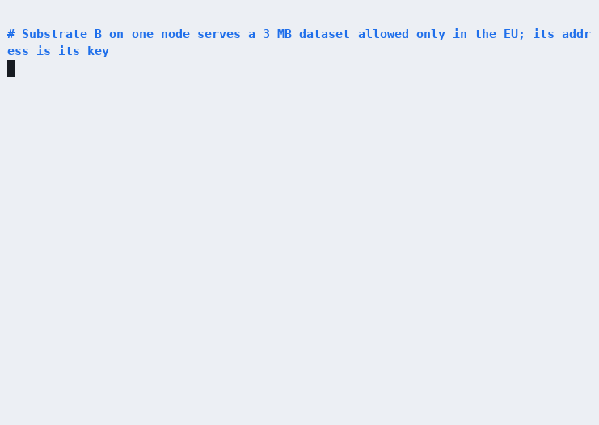

Что это доказывает и чего не доказывает. Собеседник, прошедший рукопожатие, владеет закрытым ключом идентичности. API-сервер, DNS или маршрутизатор, которые врут о точках входа, могут помешать передаче, но не могут заставить A принять байты не от B или заставить B отдать данные не той идентичности. А вот юрисдикция подложки берётся из того, что о ней заявлено в API, потому что аутентификация доказывает, кто получатель, но не где он находится. Сообщения через почтовый ящик подписаны, но не зашифрованы. Объект целиком держится в памяти, а хранилищем служит каталог с файлами. Это прототип протокола, а не плоскость данных.

Дизайном пока остаётся ящик на объектах API с шифрованием для получателя. Остаётся и перенос как шаг плана. Планировщик уже считает цену и время переноса, но ещё не заказывает его, и данные пока адресуются по имени, а не по содержимому от начала до конца. Ещё не сделаны идентичности нагрузок, наборов данных и мандатов, а не только подложек, и совместимая с SPIFFE форма для существующих сервис-мешей. Транспорт пока не выбирается по контексту. Он один, HTTP/1.1 поверх TLS 1.3 поверх TCP, а QUIC между площадками, Homa внутри ЦОДа и многопутевая передача существуют только в дизайне. Не сделано и хранение с пересылкой по Bundle Protocol для каналов, которых нет часами, потому что докачка частями переживает разрыв на секунды и минуты, но не на часы. Не заменены kube-proxy и CNI. Канал идентичности работает поверх той IP-сети, что есть на площадке, а сеть подов, сервисы и NetworkPolicy не тронуты. И нет подтверждения местоположения, поэтому юрисдикция заявлена, а не удостоверена.

Путь миграции, описанный выше, продвинулся на шаг, и идентичность уже заменила IP-адрес там, где подложки передают друг другу данные и решают, можно ли их отправить.

### Облако как рынок подложек и суверенитет

Если физика разная и принадлежит разным владельцам в разных странах, «облако» перестаёт означать провайдера с одинаковыми серверами. Облако становится рынком подложек, связанных одним контрактом. Поставщики (у кого машина Изинга в Польше, у кого квантовый процессор в Германии, у кого аналоговые ускорители во Франции) публикуют `Substrate` с моделью, ценой и юрисдикцией. Планировщик выбирает по результату и стоимости. Суверенитет (юрисдикция оператора, место данных, путь данных, аттестация подложки) становится жёстким ограничением планирования, а не галочкой в договоре. Гибридность тогда перестаёт быть архитектурой «немного своего, немного публичного» и становится нормой, потому что любая задача может уйти на любую физику у любого владельца, если это разрешено мандатом и выгодно.

### Совместимость

Новые сущности сделаны как CRD поверх обычного apiserver, поэтому kubectl, GitOps и RBAC работают с ними сразу. Поды и контейнеры остаются подложкой «процессы Linux» для старого софта, но перестают быть центром системы.

Мост от сегодняшнего описания устройств сделан. Драйвер DRA публикует устройства в `ResourceSlice`; `physis-dra-bridge` превращает каждое распознанное устройство в `Substrate`. Модели стоимости в DRA нет, поэтому драйвер может добавить её атрибутами в домене `physis.kuberoot.dev`; то, что он указал, цитируется как ссылка на драйвер, а всё, чего он не сказал, берётся из эталонной модели физики и помечается как допущение. Мост пишет только описание, а подложка оживает, когда её обслуживает агент (`physis-agent -adopt`), так что описанное, но никем не обслуживаемое устройство никогда не попадёт в план. Ради этого планировщик теперь строит модель каждой подложки из того, что она о себе публикует, а не из встроенной таблицы.

И агент подложки больше не обязан быть контейнером или даже процессом Linux. Ядро устройства, то есть счёт и подпись с ключом, который живёт только в нём, вынесено в отдельную программу `physis-device`, которая говорит построчным JSON через stdin и stdout и не требует ни сети, ни сокетов, ни Linux. Она собирается под WebAssembly (WASI) и работает в песочнице; агент вокруг неё делает только сетевую часть и ключа не видит. Тот же протокол подходит для микроконтроллера на последовательном порту. Для kuberoot сделан дистрибутив без контейнеров (`deploy/kuberoot-distro`), где на узле работают только ядро, init, API-сервер со своим хранилищем, менеджер контроллеров, API узла и сам physis как службы узла, без kubelet, containerd и подов. Он собран, загружен на сервере и проходит conformance (раздел 8.6).


---

## 7. Прототип physis

Чтобы проверить дизайн, мы собрали прототип. Его назвали physis, что по-гречески значит «природа» в смысле «то, как устроена вещь». Это около одиннадцати тысяч строк на Go под лицензией Apache 2.0. Прототип реализует ровно те объекты, что описаны выше, поверх обычного kube-apiserver, и ставится в kuberoot как пакет kubepkg или Helm-чарт, а планировщик и агенты работают обычными подами.

### Что внутри

| Компонент | Что делает |
|---|---|
| `physis-scheduler` | Следит за `Problem`, проверяет мандаты, планирует по живым подложкам и живым прогнозам энергосистем, записывает план и альтернативы. Сам ничего не исполняет и ничего не привязывает к узлам |
| `physis-agent` | Один агент на одну подложку. Публикует её модель, шлёт пульс, забирает запланированную для неё работу, исполняет, подписывает квитанцию и сообщает результат. Обычный Deployment, без привязки к узлу |
| `physis-conformance` | Набор из 17 тестов по принципу чёрного ящика (раздел 9) |
| `physis-calibrate` | Прогоняет все алгоритмы на всех физиках и строит распределения качества |
| `physis-sim` | Цифровой двойник: та же логика планировщика на потоке задач и реальных данных энергосистем за квартал |
| `physis-data` | Загружает данные энергосистем |
| CRD `Substrate`, `Problem`, `Receipt`, `Mandate`, `Link` | Объекты слоя поверх обычного kube-apiserver; `Link` описывает сеть между зонами как пути с ценой |

Ключевое архитектурное решение состоит в том, что **в коде нет ни одного обращения к объектам Node**. Роли RBAC, которые получает physis, не дают доступа ни к узлам, ни к подам; conformance-тест TC-02 это проверяет. Работа забирается оптимистичной записью статуса задачи, и из двух агентов, претендующих на одну работу, успевает тот, чья запись пришла с актуальной версией объекта.

### Две задачи

Чтобы сравнивать физики честно, нужны задачи, которые на них естественно ложатся.

**MaxCut** требует разбить вершины графа на две группы так, чтобы суммарный вес рёбер между группами был максимальным. Это классическая NP-трудная задача и одновременно каноническая задача машин Изинга. Если вершине сопоставить «спин» ±1, разрез с точностью до знака и константы равен энергии модели Изинга. Мы берём стандартный набор Gset (Helmberg и Rendl), а из него графы G1, G2, G11, G14, G22 и G43 размером от 800 до 2000 вершин. Для G1, G2 и G22 мы подтвердили опубликованные рекорды в двух независимых источниках [gset-best]. Кроме них используются небольшие случайные графы на 12–20 вершин, для которых точный оптимум находится полным перебором.

**Классификация** рукописных цифр из набора UCI (1797 тестовых изображений 8×8) [optdigits] линейной моделью. Она сводится к матрично-векторным умножениям, родной операции аналоговых вычислений в памяти, фотоники и нейроморфных чипов.

### Восемнадцать физик

Настоящих физик в прототипе две, процессор и GPU. Двенадцать физик описаны ниже. Ещё шесть добавлены позже и описаны в разделе 8.6: систолический тензорный массив (FP8, MXFP4, int8), вычисления в DRAM, dataflow-процессор, стохастические и гипермерные вычисления, перестраиваемая решётка CGRA. В роли GPU выступает графический процессор Apple M4 ноутбука. Классификатор считается на нём через MLX, а время устройства измеряется (подробнее в разделе 8.6). Остальные шестнадцать физик **эмулируются**. Алгоритм, который эта физика исполняла бы, честно выполняется на CPU и считает свои элементарные операции, а модель устройства превращает число операций во время и энергию реальной машины. У каждого параметра модели указано происхождение, будь то измерение, опубликованная цифра со ссылкой или явное допущение с диапазоном, который потом проверяется анализом чувствительности.

Это сознательный выбор, поэтому скажем прямо, что он показывает. Эмуляция не доказывает, что, скажем, p-биты в 100 раз экономнее процессора. Она проверяет **механизм**, то есть умеет ли слой описать разные физики, выбрать между ними по результату и стоимости, учиться на квитанциях и не нарушать ограничения. Когда к системе подключат настоящую машину, её модель перекалибруется по квитанциям (об этом раздел 8.4).

Каждая физика исполняет свои алгоритмы:

- **CPU**: точный перебор (до 24 вершин), локальный поиск с перезапусками, отжиг Метрополиса; классификатор в двойной точности.
- **Цифровой отжиг, сверхпроводящая (SFQ) и обратимая (адиабатическая) логика** исполняют тот же отжиг Метрополиса, то есть одну и ту же динамику на разной физике, поэтому и качество у них одно.
- **p-биты**: семплирование Гиббса с растущей обратной температурой, потому что так работают вероятностные компьютеры.
- **Когерентная оптическая машина Изинга**: динамика амплитуд параметрических осцилляторов с насыщением, шумом и обратной связью.
- **Квантовый процессор**: QAOA с линейным изменением углов на эмуляторе вектора состояния до 20 кубитов; ошибки двухкубитных вентилей учитываются глобальной деполяризующей моделью (0,5% на вентиль).
- **Аналоговая память и фотоника**: классификатор с квантованием весов, ошибкой программирования, шумом чтения и АЦП.
- **Нейроморфный чип**: классификация спайками со скоростным кодированием; чем больше тактов, тем точнее и дороже.
- **Живая культура нейронов**: резервуарные вычисления. Случайная рекуррентная сеть (эхо-сеть) с шумом изображает культуру, а линейное считывание обучается на обычном компьютере. Так с культурами работают сегодня, потому что синапсы культуры градиентом не обучишь.

Модели устройств (таблица сгенерирована из кода прототипа):

| Физика | Эмуляция | Операций/с | Энергия на операцию, Дж | Мощность, Вт | Загрузка, с | Загрузка, Дж | Калибровка | Ёмкость |
|---|---|---|---|---|---|---|---|---|
| cpu | нет | 5e+07 (1e+07–2e+08) · measured | — | 6.04 (3–9) · ref:amd-9454p | — | — | — | 1073741824 |
| ising-digital | да | 4e+09 (1e+08–4e+10) · assumption | — | 40 (15–150) · assumption | 0.002 (0.0005–0.02) · assumption | 0.08 (0.01–1) · assumption | — | 100000 |
| pbit | да | 1e+11 (1e+09–1e+12) · assumption | 2e-15 (1e-15–2e-14) · ref:singh2024 | — | 0.001 (0.0001–0.01) · assumption | 0.01 (0.001–0.1) · assumption | — | 20000 |
| analog-imc | да | 3.16e+13 (1e+12–3.16e+13) · ref:legallo2023 | 2.05e-13 (2e-14–2e-12) · ref:legallo2023 | — | 0.05 (0.01–1) · assumption | 0.001 (0.0001–0.01) · assumption | 30 с каждые 1 ч | 4194304 |
| qpu | да | 5e+03 (1e+03–2e+04) · assumption | — | 2.6e+04 (1.5e+04–3e+04) · ref:arute2019supp | 2 (0.5–30) · assumption | 5.2e+04 (7.5e+03–9e+05) · assumption | 900 с каждые 6 ч | 20 |
| optical-ising | да | 1e+09 (1e+08–1e+10) · assumption | — | 1e+03 (200–3e+03) · assumption | 0.01 (0.001–0.1) · assumption | — | — | 100000 |
| sfq | да | 2e+10 (1e+09–1e+11) · assumption | 7.4e-12 (7.4e-13–7.5e-10) · assumption | 740 (74–3.75e+04) · assumption | 0.001 (0.0001–0.01) · assumption | — | — | 50000 |
| adiabatic | да | 2e+09 (5e+07–2e+10) · assumption | 7e-09 (1e-09–9e-09) · assumption | — | 0.002 (0.0005–0.02) · assumption | — | — | 100000 |
| neuromorphic | да | 1e+10 (1e+09–1e+11) · assumption | 2.36e-11 (4e-12–2.5e-11) · ref:loihi | 1 (0.1–5) · assumption | 0.01 (0.001–0.1) · assumption | — | — | 1048576 |
| photonic | да | 1e+12 (1e+11–1e+13) · assumption | 2.7e-13 (2e-14–2e-12) · ref:photonic2024 | 5 (1–20) · assumption | 0.001 (0.0001–0.01) · assumption | — | — | 65536 |
| organoid | да | 3e+04 (3e+03–3e+05) · assumption | — | 30 (20–100) · ref:cl1power | 1 (0.1–10) · assumption | — | 3600 с каждые 24 ч | 1048576 |
| systolic | да | 4.6e+13 (4.6e+12–4.6e+13) · ref:jouppi2017tpu | — | 40 (30–75) · ref:jouppi2017tpu | 0.001 (0.0001–0.01) · assumption | 0.04 (0.003–0.75) · assumption | — | 1073741824 |
| pim-dram | да | 6e+11 (6e+10–6e+11) · ref:kwon2021fimdram | 4.6e-11 (2e-11–9.3e-11) · assumption | — | 0.0001 (1e-05–0.001) · assumption | — | — | 1073741824 |
| dataflow | да | 3.75e+14 (3.75e+13–3.75e+14) · ref:abts2020tsp | — | 300 (150–400) · assumption | 0.0001 (1e-05–0.001) · assumption | 0.03 (0.0015–0.4) · assumption | — | 1073741824 |
| stochastic | да | 1e+12 (1e+11–1e+13) · assumption | 5e-15 (1e-15–3e-14) · assumption | — | 0.0001 (1e-05–0.001) · assumption | — | — | 1073741824 |
| hdc | да | 1e+12 (1e+11–1e+13) · assumption | 6e-16 (2e-16–5e-15) · assumption | — | 0.0001 (1e-05–0.001) · assumption | — | — | 1073741824 |
| cgra | да | 6.15e+12 (1.1e+12–6.15e+12) · ref:podobas2020cgra | — | 49 (20–49) · ref:podobas2020cgra | 0.0001 (1e-05–0.01) · assumption | 0.0049 (0.0002–0.49) · assumption | — | 1073741824 |
| gpu | нет | 5e+09 (8e+08–7e+09) · measured | — | 8 (3–20) · assumption | 0.004 (0.003–0.05) · measured | 0.032 (0.009–1) · assumption | — | 1073741824 |


Несколько пояснений к таблице. Энергия квантового процессора считается как мощность установки вместе с криогеникой (около 26 кВт [arute2019supp]), умноженная на время, а не как энергия «на операцию», и сюда входят две секунды загрузки задачи, 52 кДж, которые на маленьких задачах и определяют итог. Так же и у p-битов (10 мДж) и цифрового отжига (80 мДж) основная часть энергии на малых задачах уходит на загрузку, а не на счёт. Для обратимой логики из работы Vaire взята только 30-процентная экономия [vaire], а базовую энергию обычного отжигателя, от которой она считается, мы допустили сами. Для сверхпроводящей логики энергия переключения поднята до розетки коэффициентом охлаждения 740 Вт на ватт тепла при 4 К, потому что столько обычно требуют установки на циклах Коллинза и Брайтона [cryo4k]. Предел Карно составляет около 74 Вт/Вт, лучшие установки укладываются меньше чем в 400 Вт/Вт [primavera2021], малые криокулеры требуют 5–7,5 кВт/Вт [cryo4k]. Для живой культуры основная статья расходов приходится на систему жизнеобеспечения, а не на сами нейроны, и мы берём 30 Вт, с запасом к 20 Вт, которые называют для устройства [cl1power]. Это и делает их интересными для планировщика, потому что у каждой физики свой характер затрат.

### Калибровка: что на самом деле получается

Перед планированием каждая комбинация «алгоритм × усилие × физика» прогоняется на всех экземплярах с 12 зёрнами (точные решатели один раз). Всего получилось 6405 записей калибровки, потому что одна эмуляция отжига засчитывается всем физикам с той же динамикой. Время CPU измеряется, мощность ядра берётся из спецификации EPYC 9454P [amd-9454p], всё остальное считается моделью. Вот часть результатов, отсортированная по энергии:


**MaxCut G22 (2000 вершин, 19 990 рёбер), качество — доля от рекорда 13 359**

| Физика | Алгоритм / усилие | Качество (среднее ± ст. откл.) | Время устройства | Энергия устройства |
|---|---|---|---|---|
| adiabatic | anneal / w300 | 0.9951 ± 0.0015 | 2.3 мс | 4.2 мДж |
| pbit | pbit / w300 | 0.9922 ± 0.0015 | 1.01 мс | 10 мДж |
| pbit | pbit / w3000 | 0.9969 ± 0.0013 | 1.06 мс | 10 мДж |
| pbit | pbit / w30000 | 0.9995 ± 0.0011 | 1.6 мс | 10.3 мДж |
| sfq | anneal / w300 | 0.9951 ± 0.0015 | 1.03 мс | 22.2 мДж |
| adiabatic | anneal / w3000 | 0.9987 ± 0.0013 | 5 мс | 42 мДж |
| cpu | local / s10 | 0.9605 ± 0.0022 | 10.7 мс | 64.3 мДж |
| ising-digital | anneal / w300 | 0.9951 ± 0.0015 | 2.15 мс | 86 мДж |
| ising-digital | anneal / w3000 | 0.9987 ± 0.0013 | 3.5 мс | 140 мДж |
| cpu | anneal / w300 | 0.9951 ± 0.0015 | 25.8 мс | 156 мДж |
| sfq | anneal / w3000 | 0.9987 ± 0.0013 | 1.3 мс | 222 мДж |
| optical-ising | cim / r200 | 0.9286 ± 0.0035 | 10.4 мс | 400 мДж |
| adiabatic | anneal / w30000 | 0.9999 ± 0.0001 | 32 мс | 420 мДж |
| cpu | local / s100 | 0.9639 ± 0.0017 | 105 мс | 634 мДж |
| ising-digital | anneal / w30000 | 0.9999 ± 0.0001 | 17 мс | 680 мДж |
| cpu | anneal / w3000 | 0.9987 ± 0.0013 | 261 мс | 1.58 Дж |
| optical-ising | cim / r1000 | 0.9649 ± 0.0033 | 12 мс | 2 Дж |
| sfq | anneal / w30000 | 0.9999 ± 0.0001 | 4 мс | 2.22 Дж |
| optical-ising | cim / r5000 | 0.9833 ± 0.0021 | 20 мс | 10 Дж |
| cpu | anneal / w30000 | 0.9999 ± 0.0001 | 2.46 с | 14.9 Дж |

**MaxCut на случайных графах из 20 вершин, качество — доля от точного оптимума**

| Физика | Алгоритм / усилие | Качество (среднее ± ст. откл.) | Время устройства | Энергия устройства |
|---|---|---|---|---|
| adiabatic | anneal / w300 | 1.0000 ± 0.0000 | 2 мс | 42 мкДж |
| cpu | local / s10 | 0.9978 ± 0.0079 | 16.5 мкс | 99.6 мкДж |
| sfq | anneal / w300 | 1.0000 ± 0.0000 | 1 мс | 222 мкДж |
| adiabatic | anneal / w3000 | 1.0000 ± 0.0000 | 2.03 мс | 420 мкДж |
| cpu | anneal / w300 | 1.0000 ± 0.0000 | 110 мкс | 663 мкДж |
| cpu | local / s100 | 1.0000 ± 0.0000 | 129 мкс | 782 мкДж |
| sfq | anneal / w3000 | 1.0000 ± 0.0000 | 1 мс | 2.22 мДж |
| optical-ising | cim / r200 | 0.9619 ± 0.0342 | 10 мс | 4 мДж |
| adiabatic | anneal / w30000 | 1.0000 ± 0.0000 | 2.3 мс | 4.2 мДж |
| cpu | anneal / w3000 | 1.0000 ± 0.0000 | 1.01 мс | 6.09 мДж |
| pbit | pbit / w300 | 1.0000 ± 0.0000 | 1 мс | 10 мДж |
| pbit | pbit / w3000 | 1.0000 ± 0.0000 | 1 мс | 10 мДж |
| pbit | pbit / w30000 | 1.0000 ± 0.0000 | 1.01 мс | 10 мДж |
| optical-ising | cim / r1000 | 0.9894 ± 0.0131 | 10 мс | 20 мДж |
| sfq | anneal / w30000 | 1.0000 ± 0.0000 | 1.03 мс | 22.2 мДж |
| cpu | exact / full | 1.0000 ± 0.0000 | 8.4 мс | 50.7 мДж |
| cpu | anneal / w30000 | 1.0000 ± 0.0000 | 9.97 мс | 60.2 мДж |
| ising-digital | anneal / w300 | 1.0000 ± 0.0000 | 2 мс | 80.1 мДж |
| ising-digital | anneal / w3000 | 1.0000 ± 0.0000 | 2.01 мс | 80.6 мДж |
| ising-digital | anneal / w30000 | 1.0000 ± 0.0000 | 2.15 мс | 86 мДж |
| optical-ising | cim / r5000 | 0.9964 ± 0.0071 | 10.1 мс | 100 мДж |
| qpu | qaoa / p4s256 | 0.9564 ± 0.0309 | 2.05 с | 5.33e+04 Дж |
| qpu | qaoa / p8s1024 | 0.9555 ± 0.0312 | 2.2 с | 5.73e+04 Дж |

**Классификация 1797 рукописных цифр UCI, качество — точность относительно точного классификатора**

| Физика | Алгоритм / усилие | Качество (среднее ± ст. откл.) | Время устройства | Энергия устройства |
|---|---|---|---|---|
| photonic | analog / w4 | 0.9958 ± 0.0035 | 1 мс | 6.06 мкДж |
| neuromorphic | spiking / t8 | 0.9898 ± 0.0022 | 10.3 мс | 347 мкДж |
| analog-imc | analog / w4 | 0.9771 ± 0.0051 | 50 мс | 1 мДж |
| neuromorphic | spiking / t32 | 0.9983 ± 0.0015 | 11.1 мс | 1.39 мДж |
| cpu | exact-fp / fp64 | 1.0000 ± 0.0000 | 726 мкс | 4.39 мДж |
| neuromorphic | spiking / t128 | 1.0002 ± 0.0012 | 14.5 мс | 5.55 мДж |
| organoid | reservoir / s8 | 1.0365 ± 0.0028 | 145 с | 4.31e+03 Дж |
| organoid | reservoir / s20 | 1.0340 ± 0.0019 | 360 с | 1.08e+04 Дж |


Уже из калибровки видны вещи, которые планировщик потом использует:

- На больших графах тот же отжиг на специализированных машинах обходится в 2–40 раз дешевле, чем на CPU, при одинаковом качестве, а p-биты со своим алгоритмом семплирования — до трёх порядков.
- На маленьких графах самый дешёвый вариант CPU обгоняет почти все специализированные машины, потому что у многих из них фиксированные затраты на загрузку задачи больше самого счёта. Исключение составляет обратимая логика, у которой в модели нет энергии загрузки.
- Квантовый процессор на графах из 20 вершин находит в среднем 95,6% оптимума (ошибки вентилей съедают часть качества) и тратит около 53 кДж, потому что криогеника горит всё время, пока идёт задача. Точный перебор на CPU находит оптимум за 51 мДж, то есть примерно в миллион раз дешевле. Эта модель не говорит, что квантовые компьютеры бесполезны. Она говорит, что для MaxCut на 20 вершинах они бессмысленны, и планировщик должен это видеть.
- Живая культура классифицирует цифры даже точнее линейной модели, потому что резервуар — нелинейное расширение признаков. Но на 1797 изображений у неё уходит около шести минут и около 10 кДж энергии жизнеобеспечения, то есть примерно в миллион раз больше, чем у любой другой физики на этой задаче.

### Планировщик

Для каждой задачи планировщик перебирает алгоритм × усилие × подложку × время начала. Отложенная работа рассматривается с шагом 15 минут до самого срока. Для каждого варианта он:

1. считает операции, причём для отжига, QAOA и классификации точно ещё до запуска;
2. переводит их во время и энергию по модели подложки, умножает на поправки, выученные по квитанциям, и на PUE (в прототипе одна константа 1,2);
3. добавляет энергию переноса данных, если подложка не в зоне данных;
4. проверяет окна калибровки и уже зарезервированные интервалы подложки;
5. берёт нижнюю границу Уилсона для вероятности достичь качества по наблюдённым запускам (без наблюдений вариант не предлагается);
6. считает углерод по **прогнозу** интенсивности энергосистемы на окно исполнения и деньги — по цене часа на рынке на сутки вперёд;
7. отбрасывает всё, что нарушает срок, бюджет, зоны, юрисдикции и мандат.

Затем он выбирает минимум по политике (минимум углерода, энергии, денег или времени) и сохраняет границу Парето, то есть набор вариантов, ни один из которых не хуже другого по всем осям сразу.

### Данные энергосистем

Интенсивность выбросов для Германии, Франции и Польши мы считаем сами по структуре генерации из Energy-Charts (Fraunhofer ISE) [energy-charts] с медианными коэффициентами жизненного цикла IPCC AR5 [ipcc2014]. Для этих стран мы прогнозируем наивно и берём ту же четверть часа сутками раньше. Для Великобритании берутся официальные прогноз и факт оператора энергосистемы [uk-ci]. Цены берутся с рынка на сутки вперёд (CC BY 4.0, Bundesnetzagentur | SMARD.de), а для Великобритании открытой цены нет. Испанию мы исключили, потому что её ценовые данные запрещено использовать вне частных целей.

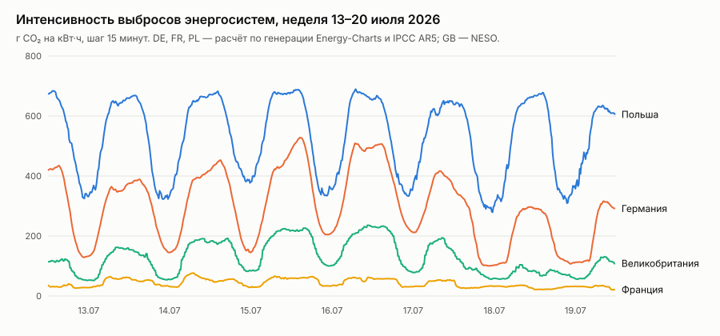

Средние значения за третий квартал 2026 года хорошо показывают, насколько разные эти сети. Суточный ритм хорошо виден на графике. Днём, когда светит солнце, интенсивность в Германии падает в два с половиной раза, в Польше — почти вдвое, а вечером снова растёт, и отсюда выгода от переноса гибкой работы во времени. Во Франции с её атомом интенсивность около 39 г CO₂ на кВт·ч, в Великобритании — около 118, в Германии — около 293, в Польше с её углём — около 505. Средняя ошибка нашего наивного прогноза для Германии составляет 67 г/кВт·ч, а у официального британского прогноза она равна 12. Ниже мы покажем, сколько стоит эта разница.

### Квитанции и мандаты

Каждый агент при первом запуске создаёт ключ Ed25519 и публикует открытую часть в статусе своей подложки. Квитанция содержит: кто попросил и под каким мандатом; хэш экземпляра, алгоритм, усилие, сборку агента и зерно; подложку, физику и признак эмуляции; хэш и качество результата; число операций, время и энергию устройства, процессорное время хоста, интенсивность сети и выбросы. Квитанция подписана и содержит хэш предыдущей квитанции того же агента. Изменить или удалить квитанцию незаметно нельзя, потому что ломается подпись или следующее звено. Сам объект `Receipt` неизменяем на уровне API, это задано правилом валидации CRD.

Мандат подписывает человек. Он делегирует пространство имён, бюджет на день в джоулях, евро и граммах CO₂, зоны, срок действия и уровень автономии: «ручной» — одобрять каждый план; «усиленный» — одобрять планы выше порога; «направляемый» — агенты действуют сами в пределах бюджета. Ключи людей зарегистрированы в control plane, а подпись проверяется при каждой задаче.


---

## 8. Как мы проверяли

### 8.1. Методика

Проверка шла на трёх уровнях, и у каждого своя роль.

1. **Калибровка на реальном процессоре.** Каждая комбинация «алгоритм × усилие × физика» прогонялась на всех экземплярах с 12 зёрнами, и всего получилось 6405 записей калибровки. Это настоящие вычисления, в которых разрезы считаются, классификаторы классифицируют, качество измеряется против рекордов и точных решений. Время CPU измерено, время и энергия остальных физик посчитаны моделью по числу операций. Двенадцать повторов взялись не с потолка. При пяти повторах планировщик отказывался планировать G22, потому что пять успехов из пяти дают нижнюю границу Уилсона 0,83, а требовалось 0,9. Система отказывалась обещать то, что недостаточно проверила, как того и требует принцип П5.

2. **Цифровой двойник на реальных данных энергосистем.** Симулятор использует тот же код планировщика. Поток примерно из 13 тысяч задач за квартал приходит днём вдвое чаще, чем ночью. Половина задач интерактивная (срок 60 секунд, ждать нельзя), половина пакетная (срок от 2 до 24 часов, ждать можно). Каждая пятая задача может выполняться только в ЕС, каждая десятая — только в зоне своих данных. Взяты два квартала 2026 года, первый (зима) и третий (лето), с данными Германии, Франции, Польши и Великобритании с шагом 15 минут. Парк подложек состоит из CPU-пулов по 16 слотов в каждой стране и по одной машине каждой из десяти особых физик у разных «владельцев» в разных странах. Планировщик видит только **прогноз**, а углерод и деньги начисляются по **факту** часов, в которые работа реально шла. Итог исполнения берётся из калибровки. Качество выбирается случайно из реально наблюдённых значений для этой комбинации, а затраты берутся из модели с разбросом ±10% (логнормальный шум). Каждая политика прогоняется с пятью зёрнами; приводим среднее и диапазон 5–95%.

3. **Живые стенды.** Первый стенд состоит из настоящего kube-apiserver 1.37 с etcd без единого узла, а планировщик и 14 агентов работают процессами. Он нужен, чтобы показать, что системе вообще не нужны объекты Node. Второй стенд — **кластер kuberoot `edge`**. Дистрибутив собран из исходников под arm64 (ядро Linux 6.18.55, модули DRBD, корневая файловая система, носитель 403 МБ) и загружен в QEMU с аппаратной виртуализацией. Узел поднимается кластером из одного узла на Kubernetes 1.37.1, а physis ставится в него из Helm-чарта, входящего в пакет kubepkg (чарт рендерится и применяется kubectl). Образ physis кладётся в реестр на самом узле, и containerd забирает его с loopback. Все 15 компонентов physis (планировщик и 14 агентов) работают на kuberoot как поды. На обоих стендах использовались живые прогнозы энергосистем на день запуска, поток из 120 задач в реальном времени и conformance-набор. Ещё два стенда, кластеры kuberoot из нескольких узлов, на которых проверялся настоящий разрыв сети, описаны в разделе 8.6.

Сравнивались семь политик:

| Политика | Что это |
|---|---|
| **Kubernetes сегодня** | Только CPU, только в зоне данных, сразу, как можно быстрее. Так устроено большинство кластеров |
| **Углеродно-осознанная, только CPU** | Только CPU, но в любой разрешённой зоне и с переносом во времени на минимум углерода — так устроены сегодняшние «зелёные» планировщики |
| **Разная физика, только скорость** | Все физики, но цель — закончить как можно раньше, без учёта энергии |
| **physis: минимум энергии** | Все физики, все зоны, без ожидания |
| **physis: минимум углерода** | Все физики, все зоны, с ожиданием до срока |
| **physis: минимум денег** | То же, цель — деньги |
| **Оракул** | Как «минимум углерода», но видит фактическую интенсивность вместо прогноза: верхняя граница того, что даёт идеальный прогноз |

### 8.2. Главный результат

Третий квартал 2026 года, около 13 тысяч задач на прогон, пять прогонов:

| Политика | Энергия, Вт·ч | Углерод, г CO₂ (5–95%) | Против «Kubernetes сегодня» | Среднее ожидание | Срывы срока | Недобор качества |
|---|---|---|---|---|---|---|
| Kubernetes сегодня | 11,17 | 2,525 (2,43–2,61) | — | 0 | 0 | 0,73% |
| Углеродно-осознанная, только CPU | 12,19 | 0,797 (0,78–0,81) | энергия +9%, углерод −68% | 162 мин | 0 | 0,73% |
| Разная физика, только скорость | 2,97 | 0,671 (0,65–0,69) | −73%, −73% | 0 | 0 | 0,73% |
| **physis: минимум энергии** | **1,17** | 0,220 (0,21–0,23) | **−90%**, −91% | 0 | 0 | 0,93% |
| **physis: минимум углерода** | 1,23 | **0,190** (0,19–0,20) | −89%, **−92%** | 163 мин | 0 | 0,91% |
| physis: минимум денег | 395,1 | 13,31 (12,8–14,3) | **+3437%, +427%** | 171 мин | 0,002% | 0,89% |
| Оракул | 1,23 | 0,185 (0,18–0,19) | −89%, −93% | 173 мин | 0 | 0,91% |

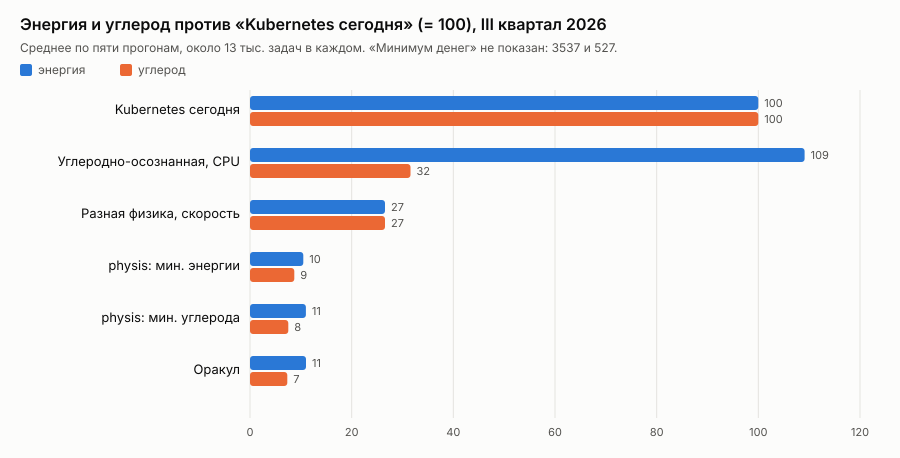

Первый квартал (зима) даёт ту же картину: «минимум энергии» снижает энергию на 89% и углерод на 91%, «минимум углерода» снижает углерод на 92%, оракул — тоже на 92%, а углеродно-осознанный CPU снижает углерод на 69% ценой роста энергии на 9%.

Из этих цифр следуют четыре вывода.

**Выбор физики даёт больше, чем выбор места и времени вместе взятые.** Перенос по времени и месту на одних процессорах (то, что сегодня называют углеродно-осознанным планированием) снимает около 70% углерода, но добавляет 9% энергии и заставляет пакетную работу ждать в среднем почти три часа. Одна только смена физики, даже без всякой цели по энергии, даёт −73% по обоим показателям без ожидания. physis с целью по энергии даёт минус 90% энергии и 91% углерода, тоже без ожидания. Ожидание чистых часов добавляет сверху ещё 14% экономии углерода.

**Цели надо выбирать осознанно: «минимум денег» — опасная цель.** На рынке на сутки вперёд бывают отрицательные цены. Энергосистема платит за потребление, когда избыток ветра и солнца некуда девать. В третьем квартале 2026 года так было в 7,6% четвертей часа в Германии, в 6,5% во Франции и в 3,7% в Польше (там минимум доходил до −120 € за МВт·ч). Планировщик, минимизирующий деньги, в такие часы выбирает самый энергоёмкий вариант, живую культуру нейронов с её жизнеобеспечением (3,6% задач), и в сумме тратит в 35 раз больше энергии, чем Kubernetes, буквально зарабатывая на этом. С точки зрения сигнала цены это правильное поведение, потому что сети нужна нагрузка, а с точки зрения углерода и здравого смысла неправильное. Для дизайна отсюда следует, что деньги нельзя делать единственной целью и нужна составная цель или ограничение по энергии и углероду поверх денег. Мандаты с дневным бюджетом в джоулях и граммах (принцип П10) дают один из способов это сделать.

**Прогноз стоит немного.** Оракул, видящий будущее точно, лучше нашего наивного прогноза «как вчера» всего на 2,5% углерода в третьем квартале и на 2,6% в первом. Почти вся выгода приходит от выбора физики и от ожидания как такового, а не от точности прогноза.

**Сроки практически не нарушаются.** Единственный срыв за пять прогонов случился у политики «минимум денег». Недобор качества затрагивает меньше 1% задач при заявленной 90-процентной нижней границе уверенности. У политик physis он чуть выше (0,9% против 0,7%), потому что они чаще берут минимальное усилие, которое по статистике ещё укладывается в цель.

### 8.3. Перенос данных: вычисления должны идти к данным

В первой версии симулятора энергия переноса данных начислялась по углероду страны назначения, и планировщик охотно увозил задачи во Францию с её атомной энергетикой, так что туда уезжало до трети работы. Это была ошибка модели. Данные идут по сетям между странами, и честнее считать перенос по средней интенсивности источника и назначения. После исправления физически увезённой оказалась только та работа, которую заставляли увозить ограничения суверенитета, то есть 4,8% задач. Добровольно планировщик не перенёс ни одной.

Причина в масштабах. По оценке Аслана и соавторов, передача данных по магистральным и фиксированным сетям доступа стоила 0,06 кВт·ч на гигабайт в 2015 году и дешевела вдвое примерно каждые два года [aslan2018]. Экстраполяция на 2026 год даёт около 4,8 мкДж на байт. Граф G22 весит около 480 КБ, и его перенос стоит порядка 2,3 Дж. Решение той же задачи на обратимой логике стоит 4 мДж, в пятьсот раз меньше. Чем экономнее становится физика вычислений, тем сильнее перенос данных доминирует в счёте. Это та же закономерность, которую Марк Хоровиц показал внутри чипа, где обращение к памяти стоит на порядки больше арифметической операции [horowitz2014]. Только теперь она проявляется в масштабе энергосистем и стран. Мы прогнали эксперимент с объёмом данных от 65 байт до 100 МБ на одно изображение, и доля добровольных переносов во всех случаях осталась нулевой.

Внутризонный перенос мы приняли в десять раз дешевле межзонного, и это допущение. Но вывод от него не зависит. В мире, где вычисление дешевеет на порядки, а сеть — вдвое за два года, **планировщик должен везти вычисление к данным, а не наоборот**. Для дизайна это аргумент за перенос данных как явную, планируемую операцию с ценой (раздел 6) и против плоской сети, где перенос невидим.

### 8.4. Модель ошибается — система учится

Самый важный вопрос к эмуляции состоит в том, что будет, если модель реальной машины окажется неверной. Мы проверили это напрямую. Пять физик (цифровой отжиг, SFQ, обратимая логика, p-биты и фотоника) в «мире» тратят в 30 раз больше энергии, чем считает модель планировщика. Это достаточно, чтобы доверие к модели вело к неправильному выбору физики. Сравнивались три варианта:

| Вариант (3-й квартал) | Энергия, Вт·ч | Углерод, г | Работы на «ошибочных» физиках | Ошибка прогноза: первые 10 запусков → первые 100 → конец квартала |
|---|---|---|---|---|
| Без обучения | 11,97 | 2,99 | 64,6% | 67% → 74% → 73% |
| **С обучением по квитанциям** | **5,42** | **0,78** | 29,7% | **32% → 7,6% → 4,4%** |
| Истина известна заранее | 5,41 | 0,74 | 30,3% | 3% → 4,4% → 4,2% |

Без обучения планировщик продолжает верить модели и тратит в 2,2 раза больше энергии. С обучением ошибка прогноза падает с 32% на первых десяти запусках до 7,6% на первых ста и упирается в уровень шума (около 4–5%). Итоговые энергия и доля работы на «ошибочных» физиках практически совпадают с вариантом, где истина известна заранее. В первом квартале цифры те же.

Именно поэтому эмуляция в прототипе не лажа, а постановка эксперимента. Модель подложки служит стартовой гипотезой, а не утверждением. На реальном железе система сама сведёт её с фактом по квитанциям за первые сотни запусков.

По пути этот эксперимент нашёл ещё одну ошибку. Сначала обучение не сходилось, ошибка стояла около 60%, потому что квитанции сравнивались с уже скорректированным прогнозом и система учила «поправку к поправке». Теперь факт сравнивается с сырым предсказанием модели, без поправок, накладных расходов площадки и переноса данных.


### 8.5. Насколько выводы зависят от допущений

Большинство параметров эмулированных физик заданы допущениями с диапазонами. Мы по очереди сдвигали каждую физику на пессимистичный край её диапазона (энергия и мощность — максимум, скорость — минимум) и на оптимистичный, причём одновременно и в «мире», и в модели планировщика. Затем смотрели, какую долю работы эта физика получает и что происходит с суммарным углеродом. На каждую точку приходилось три прогона в обоих кварталах; ниже приведён третий квартал, а первый даёт те же выводы.

| Физика | Доля работы (мин. углерода): пессим. / номинал / оптим. | Углерод всего, г: пессим. / номинал / оптим. |
|---|---|---|
| Обратимая логика | 30,8% / 31,2% / 32,3% | 0,191 / 0,189 / 0,185 |
| p-биты | 6,2% / 8,7% / 8,9% | 0,192 / 0,189 / 0,189 |
| Фотоника | 2,3% / 2,3% / 2,3% | 0,189 / 0,189 / 0,189 |
| Нейроморфный чип | 0% / 2,2% / 2,2% | 0,189 / 0,189 / 0,189 |
| Цифровой отжиг | **0%** / 8,6% / 13,7% | **0,349** / 0,189 / 0,146 |
| SFQ | **0%** / 13,3% / 18,2% | **0,250** / 0,189 / 0,146 |
| Квантовый процессор, оптическая машина Изинга, живая культура, аналоговая память | 0% при любых параметрах | без изменений |

По этой таблице физики делятся на три группы. **Устойчивые** — обратимая логика, p-биты, фотоника и нейроморфный чип: их доли почти не зависят от того, где в диапазоне допущений лежит правда.

- **Устойчивые.** Доли обратимой логики, p-битов, фотоники и нейроморфного чипа почти не зависят от того, где в диапазоне допущений лежит правда.
- **Зависящие от допущений.** Роль цифрового отжига и сверхпроводящей логики целиком определяется их скоростью, мощностью и, для SFQ, ценой охлаждения, и на пессимистичном краю планировщик перестаёт их выбирать, а углерод в сумме растёт на 32–84%. Для этих физик нужна калибровка на реальном железе, прежде чем делать выводы.
- **Никогда не выбираемые** для этих задач: квантовый процессор (криогеника съедает всё на задачах до 20 вершин), оптическая машина Изинга (у неё и качество хуже, и энергия выше), живая культура (медленно и дорого из-за жизнеобеспечения) и аналоговая память (фотоника решает ту же классификацию точнее и дешевле). Это не приговор физикам, а свойство этих задач и этих моделей, и как раз его планировщик должен уметь видеть.

Самое важное для всей статьи то, что **даже на самом пессимистичном краю любой физики суммарный углерод physis на 84% ниже, чем у «Kubernetes сегодня»** (0,40 г против 2,52 г в третьем квартале, 0,47 г против 2,95 г в первом). Чувствительность меняет то, какая особая физика выигрывает, но не то, что выигрывает выбор физики.

При этом физики сдвигались по одной, а не все сразу, и диапазоны выбраны нами. Совместный пессимистичный сценарий станет следующей проверкой.


**Воспроизводимость.** Все симуляции мы прогнали заново с нуля в сборочном поде кластера воркшопов, то есть на серверном процессоре AMD EPYC 9454P под Linux, а не на ноутбуке с Apple M4 под macOS. С той же опубликованной калибровкой итоговые таблицы всех четырёх опытов за оба квартала совпали с опубликованными байт в байт, а в сводных файлах числа разошлись меньше чем на одну миллиардную долю, что объясняется разной арифметикой с плавающей точкой на двух архитектурах. Затем мы сделали то, чего опубликованные цифры не делали: заново откалибровали все физики на самом EPYC (9429 записей, `results/repro/`) и повторили главный опыт. Процессор сервера считает наши задачи медленнее, чем M4, поэтому базовая линия «Kubernetes сегодня» стала примерно в полтора раза дороже по энергии, а политики physis почти не изменились. В итоге выигрыш вырос: в третьем квартале physis с целью по энергии снижает энергию на 93% и углерод на 94% против 90% и 91% в опубликованной версии. Это та самая неточность, о которой сказано в ограничениях: скорость M4 вместе с мощностью EPYC делала процессор в симуляции немного выгоднее, чем он есть, то есть опубликованные цифры осторожнее, чем следует из калибровки на настоящем серверном процессоре.

### 8.6. Живые стенды


*Запись сделана скриптом `hack/demo.sh` на стенде без узлов; всё, что в ней видно, — живой вывод `kubectl`.*

Поток из 120 задач в реальном времени (MaxCut на графах Gset и случайных графах, классификация цифр, четыре разные политики, у трети задач ограничение «только ЕС») прошёл на обоих стендах с живыми прогнозами энергосистем на 8 ноября 2026 года. Последовательность задач одинаковая (фиксированное зерно), поэтому стенды можно сравнивать. На control plane без узлов:

- выполнены **все 120 задач**; сроки не нарушены;
- работа разошлась по пяти физикам: обратимая логика — 47 задач, фотоника — 27, CPU — 26, p-биты — 12, SFQ — 8;
- качество не дотянуло до цели в 3 случаях из 120 (2,5%), то есть в пределах заявленной 90-процентной уверенности;
- от создания задачи до того, как агент её забрал, в медиане проходит 2,3 с, на 95-м перцентиле — 3,7 с. Это цена опроса, потому что планировщик проверяет задачи раз в 2 секунды, а агент раз в секунду;
- все 120 квитанций прогона в шести цепочках проверены открытыми ключами подложек без доступа к системе.

На kuberoot, где physis работает подами:

- выполнены **все 120 задач**, сроки не нарушены, распределение по физикам то же: обратимая логика — 47, фотоника — 27, CPU — 26, p-биты — 12, SFQ — 8. Планировщик принимает те же решения на том же входе, где бы он ни работал;
- недобор качества — 3 из 120;
- захват работы — 2,4 с в медиане, 3,6 с на 95-м перцентиле;
- после прогона все 132 квитанции в 7 цепочках проверены открытыми ключами подложек, подделанная копия отвергнута;
- отложенная работа видна вживую: в тесте TC-09 гибкую задачу с суточным сроком планировщик поставил на 18–19 часов позже, на полдень следующего дня, когда по прогнозу французская сеть давала 63 г CO₂ на кВт·ч.

Kuberoot нашёл ещё одну ошибку, которую стенд без узлов пропустил. Зерно генератора в квитанции хранится как 64-битное целое, а при преобразовании объекта для API оно проходило через число с плавающей точкой и теряло младшие разряды. Подпись ставилась над точным значением, а хранилось округлённое. На kuberoot тест TC-10 честно отверг такую квитанцию. Числа теперь передаются точно, а модульный тест проверяет полный круговой проход квитанции через API.

**Вторая настоящая физика: GPU.** На стенде без узлов к 14 агентам добавлен пятнадцатый, `gpu-m4`, который отдаёт классификацию графическому процессору Apple M4 через MLX (`tools/gpu-worker.py`) и измеряет время на самом GPU, отдельно подготовку ядер Metal и сам счёт. Калибровка на 21 партии дала качество, равное точному классификатору (float32 не меняет ни одного ответа), пропускную способность от 8·10⁸ умножений-сложений в секунду на партии из 1797 изображений до 6,5·10⁹ на синтетической партии из 200 000 и подготовку 3–14 мс (около 50 мс с холодным кэшем ядер; отдельный замер в `hack/gpu-benchmark.py`, `results/gpu-throughput-benchmark.txt`). Conformance на стенде с GPU даёт 17 из 17.

Затем одни и те же партии мы прогнали на настоящем CPU и настоящем GPU, по пять раз (`results/real-cpu-vs-gpu.json`, медианы):

| Партия | CPU, время | CPU, энергия | GPU, время | GPU, энергия |
|---|---|---|---|---|
| 100 изображений | 0,14 мс | 0,8 мДж | 5,5 мс | 44 мДж |
| 500 | 0,29 мс | 1,7 мДж | 6,0 мс | 48 мДж |
| 1797 | 1,1 мс | 6,9 мДж | 6,7 мс | 53 мДж |

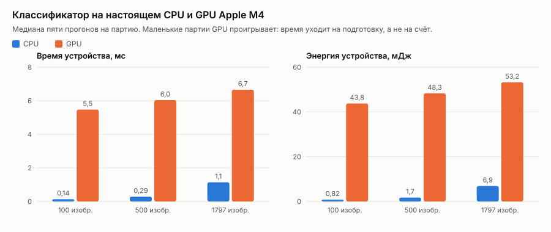

На таких партиях GPU проигрывает CPU в 6–40 раз по времени и в 8–50 с лишним раз по энергии, потому что всё съедает подготовка, а не счёт. Энергия здесь равна измеренному времени, умноженному на модельную мощность, которая для CPU берётся как доля TDP серверного EPYC, а для GPU допущена. По измеренным скоростям время сравняется примерно на 12 тысячах изображений, а энергия позже, и где именно, зависит от мощности GPU, которую мы пока не измеряем. Планировщик без поправок по квитанциям ошибается вместе с моделями. При цели 1,0 он выбирает GPU (это видно на записи стенда выше), хотя настоящий CPU на этой партии в восемь раз экономнее. Этот же опыт показывает, зачем нужны квитанции. Модель CPU с начальной, не откалиброванной скоростью завышала время в 9–22 раза, а модель GPU занижала его на треть, и то и другое планировщик исправляет по квитанциям (раздел 8.4).

**Kubernetes без контейнеров и без узлов.** Последним стендом стал узел kuberoot из дистрибутива `physis`, собранный в кластере воркшопов и загруженный в виртуальную машину на одном из серверов этого кластера. На нём работают только службы самой ОС: хранилище kine, API-сервер, менеджер контроллеров, API узла kuberoot, планировщик physis и агенты подложек, сначала двенадцать, а в последней сборке все двадцать эмулируемых. `kubectl get nodes` и `kubectl get pods -A` возвращают пустоту, потому что в этом кластере нет ни одного объекта Node и ни одного пода, а на узле нет containerd и kubelet. Conformance-набор проходит **17 из 17** и с двенадцатью подложками, и со всеми двадцатью (`results/containerless-node*.txt`, `results/conformance-kuberoot-containerless-*.json`). Первая сборка с восемью подложками дала 15 из 17, потому что TC-13 на время глушит одну подложку, и для MaxCut оставалась одна физика, а для TC-14 не было медленной подложки, которую можно отрезать посреди работы. Это требование к составу подложек, а не к ядру, и с двенадцатью подложками тесты проходят. При загрузке агенты дважды перезапускаются, пока поднимается API-сервер, так что порядок служб в профиле можно уточнить.

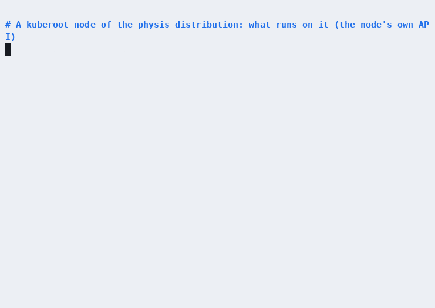

**Мост от DRA.** На стенде мы опубликовали `ResourceSlice` с одним устройством, GPU Apple M4 ноутбука, для которого драйвер указал скорость и время подготовки, а про мощность промолчал. `physis-dra-bridge` создал подложку `dra-m4-gpu0`, в модели которой скорость и подготовка подписаны ссылкой на драйвер, а мощность и энергия подготовки — допущением. Агент с флагом `-adopt` взял её на обслуживание, не меняя описания, и решил задачу классификации на настоящем GPU (`results/dra-bridged-*.json`). То же мы повторили на кластере kuberoot из четырёх узлов: устройство `cpu.example.com/rack-7/cpu0`, для которого драйвер указал только мощность, стало подложкой, агент-под взял её на обслуживание, и задача, разрешённая только под юрисдикцией CH, ушла на неё (`results/dra-cluster-*.json`).

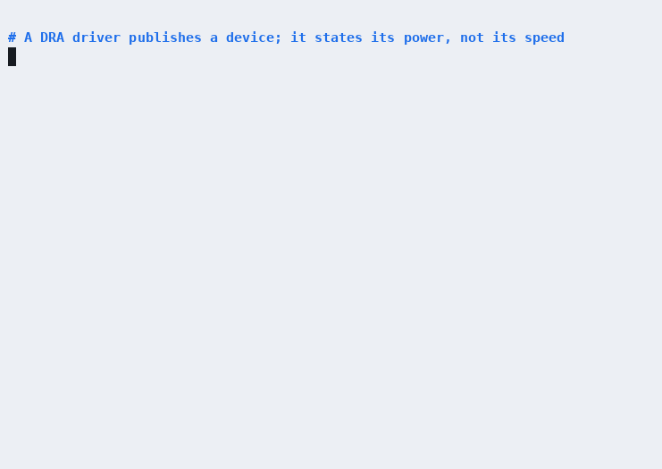

**Иерархия планирования.** Единый планировщик мы заменили глобальным и двумя планировщиками площадок, для DE и FR, и подали поток из 12 задач, разрешённых во всех четырёх зонах. Глобальный уровень выбрал зону FR и передал задачи площадке, которая выбрала подложку, и все 12 спланированы площадкой FR. Затем мы остановили глобальный уровень и подали ещё 12 задач, из которых шесть разрешены только в DE, а шесть везде. Без центра площадка DE сама спланировала все шесть задач своей зоны, а задачи без привязки к зоне подхватила площадка FR. Повторных планирований не было, двойного запуска тоже, потому что две площадки, взявшиеся за одну задачу, разводит оптимистичная блокировка API (`results/hierarchy-problems.json`).

На кластере kuberoot, где уровни работают подами, первый прогон показал смешанную картину: часть задач глобальный уровень планировал сам, а часть площадки забирали при живом центре. Причин нашлось две. API-сервер отклонял каждое продление аренды, потому что время в ней было записано с наносекундами, а поле принимает только микросекунды; кроме того, аренда продлевалась в начале цикла планирования, и на поде с ограниченным процессором цикл длился дольше допустимого. Теперь аренда продлевается по своему таймеру и в правильном формате, а свежесть уровня оценивается так же, как при выборе лидера в client-go: по тому, что значение аренды меняется, а не по сравнению чужих часов со своими. После исправления на кластере всё прошло как на стенде: глобальный уровень передал все 12 задач площадке FR, а без центра площадки спланировали свои задачи сами (`results/hierarchy-cluster-*`).


**Ядро устройства в WASI-песочнице.** Агент `wasi-cpu-ch` на стенде не считает и не подписывает сам, за него это делает `physis-device`, собранный под WebAssembly и запущенный в wasmtime с доступом только к своему каталогу состояния и к данным. Ключ подписи создан внутри песочницы и наружу не выходит. Пять задач MaxCut на графе G1 решены с качеством 0,994–0,996, квитанции подписаны ключом из песочницы и проходят проверку цепочки (TC-10) (`results/wasi-device-*.json`). Попутно этот опыт нашёл ошибку в только что добавленном локальном уровне, где агент дважды брал собственную блокировку и замирал после первого результата. Исправлено до публикации.

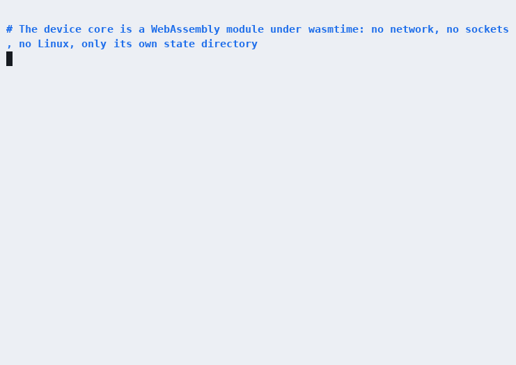

**Агенту — MCP.** На живом стенде и затем на кластере kuberoot инструмент `plan` из `physis-mcp` вернул пробный план с альтернативами и машиночитаемыми причинами, `submit` с `requestID` создал задачу, а повторный `submit` с тем же `requestID` вернул уже существующую задачу и не создал вторую (`results/mcp-cluster.jsonl`). Невыполнимый запрос отклоняется с кодом `QualityUnreachable`, по которому агент может решить, что делать дальше.


**Пять архитектур, меняющих способ вычисления.** К стенду добавлены пять подложек: систолический тензорный массив (по образцу TPU), вычисления в DRAM (HBM-PIM), dataflow-процессор (Groq), стохастические и гипермерные вычисления. Их эмуляторы честно делают то, что делало бы железо, то есть квантуют веса и входы до FP8 или FP4 с блочным масштабом, считают в int8 с 32-битным накоплением, кодируют числа случайными потоками битов, строят и обучают гипервекторы. Поэтому качество ответа измеряется, а не предполагается. Время и энергию дают модели устройств с источниками: пиковая скорость TPU v1 и его мощность [jouppi2017tpu], пиковая скорость Groq [abts2020tsp] (мощность — допущение, в источниках её нет), скорость HBM-PIM [kwon2021fimdram] с энергией, выведенной из стоимости чтения DRAM [horowitz2014] и выигрыша PIM [lee2021pim], и допущения с диапазонами для стохастических и гипермерных схем. Калибровка дала 3024 записи (`results/calibration-numeric-runs.csv`). Результаты на партии из 1797 изображений (качество — доля от точного классификатора):

| Подложка | Вариант | Качество | Энергия на партию |
|---|---|---|---|
| Тензорный массив | int8 | 1,000 | 40 мДж |
| Тензорный массив | FP8 (E4M3) | 0,999 | 40 мДж |
| Тензорный массив | MXFP4 (E2M1) | 0,984 | 40 мДж |
| DRAM с вычислениями | int8 | 1,000 | 53 мкДж |
| Dataflow | int8 | 1,000 | 30 мДж |
| Стохастические | поток 64 бита | 0,975 | 0,37 мкДж |
| Стохастические | поток 1024 бита | 0,998 | 5,9 мкДж |
| Гипермерные | 512 измерений | 0,964 | 0,04 мкДж |
| Гипермерные | 2048 измерений | 1,007 | 0,16 мкДж |

Из таблицы следуют три вывода. Пониженная точность почти бесплатна для качества, потому что FP8 теряет одну тысячную, int8 ничего не теряет, а FP4 теряет полтора процента. Стохастические и гипермерные схемы покупают качество длиной потока и размерностью, ровно как отжиг покупает его шагами. А на маленьких партиях тензорный массив и dataflow-процессор проигрывают памяти с вычислениями, потому что их энергия уходит на подготовку и мощность целой карты, а не на умножения (у тензорного массива три варианта стоят одинаково по той же причине).

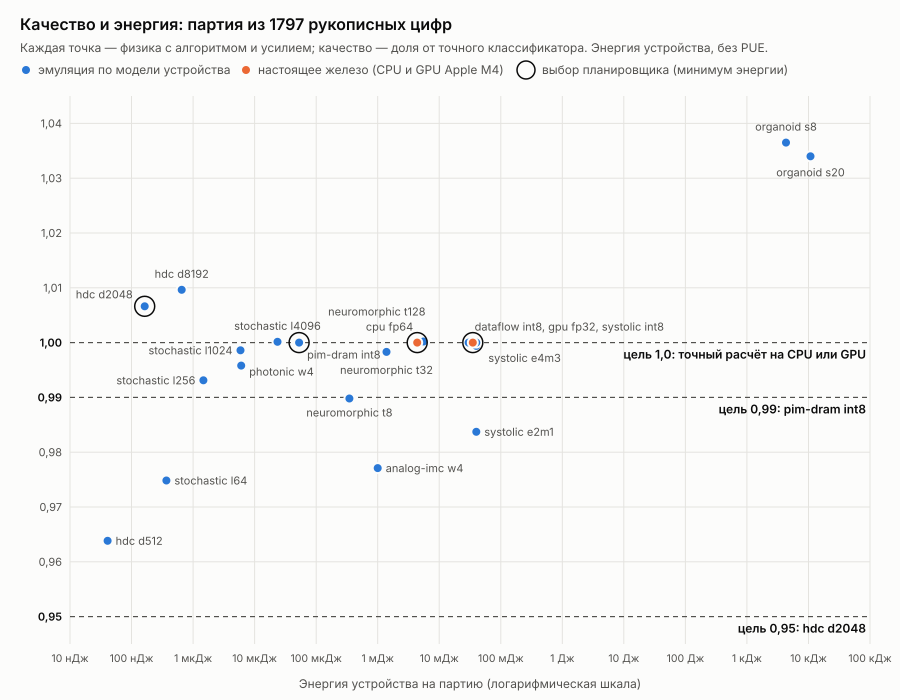

Главное же в том, что выбор зависит от требуемого качества. Мы спросили планировщик о партии из 1797 изображений (пробный план, минимум энергии). При цели 0,95 он берёт гипермерные вычисления на 2048 измерениях (около 0,2 мкДж с учётом PUE), при цели 0,99 они уже не проходят по уверенности, и планировщик переходит на int8 в памяти (64 мкДж), а при цели 1,0 остаются только точные вычисления на CPU и GPU. С политикой «быстрее всего» при целях 0,95 и 0,99 выигрывает dataflow-процессор. Conformance на стенде со всеми 20 подложками даёт 17 из 17.

Последней добавлена перестраиваемая решётка CGRA с параметрами Plasticine, то есть 12,3 TFLOP/s при мощности не больше 49 Вт [podobas2020cgra], причём нижняя граница скорости учитывает, что реальные приложения получают 18–25% пиковой производительности. Она выполняет те же отжиг и точный классификатор, что и процессор, поэтому качество у неё то же, а различаются скорость и энергия. Калибровка дала 669 записей (`results/calibration-cgra-runs.csv`). С ней на стенде 21 подложка, conformance снова даёт 17 из 17, а решётка сразу появляется на границе компромиссов. В пробных планах с политикой «быстрее всего» она выигрывает MaxCut на графе G22 у обратимой логики и p-битов, а в классификации стоит в одном ряду с памятью с вычислениями и dataflow-процессором.

**Кластер kuberoot из двух машин и настоящий разрыв сети.** Третий стенд состоит из двух виртуальных машин kuberoot `edge` с тех же носителей. У каждой два сетевых интерфейса, один для выхода наружу, а второй для прямого канала между машинами с адресами 10.0.0.11 и 10.0.0.12. Первая машина служит управляющим узлом, а вторая вошла в кластер рабочим узлом по одноразовому JoinTicket. Агенты разнесены по машинам поровну, семь на семь, ограничением распределения в Helm-чарте; планировщик закреплён на управляющем узле. Conformance-набор на этом кластере проходит **17 из 17**.

Второй узел прежде всего позволяет проверить разрыв на уровне сети, а не аннотации. Привилегированный под на рабочем узле отключает его интерфейс кластерной сети и через заданное время включает обратно. Агенты на рабочем узле теряют связь с API-сервером целиком, вместе с пульсом, захватом работы и отчётами.

- **Поток во время разрыва.** Поток из 120 задач, на 90-й секунде связь рабочего узла пропадает на две минуты. Выполнены все 120 задач. 41 задачу за время разрыва забрали подложки управляющего узла, подложки отрезанного узла — ни одной. Ни одна задача не застряла на подложке, которая молчит, потому что планировщик перестал предлагать их, как только устарел их пульс. После возвращения связи агенты рабочего узла снова начали забирать работу.
- **Работа, взятая до разрыва.** Агент живой культуры перенесён на рабочий узел, ему дана партия из 100 изображений, и как только он её забрал, связь пропадает на 90 секунд. Работа закончилась через 11 секунд после захвата, уже без связи. Отчёт с подписанной квитанцией пришёл через 2 секунды после того, как связь вернулась.

**Кластер kuberoot на серверах.** Четвёртый стенд повторяет то же самое на настоящем железе, а не на ноутбуке. В кластере воркшопов Cozystack (серверы Hetzner) мы завели отдельный тенант, собрали kuberoot `edge` под amd64 прямо в кластере и подняли виртуальные машины KubeVirt. В итоге кластер kuberoot из четырёх узлов стоит на трёх физических серверах: управляющий узел — на ws1, два рабочих — на ws3, ещё один рабочий — на ws2. Рабочие вошли в кластер по JoinTicket, поды physis (14 агентов и планировщик) разнесены по узлам 4, 4, 4 и 3.

Сначала в кластере было три узла, управляющий на ws1 и два рабочих на ws3, и на нём прошли conformance (17 из 17), разрыв рабочего узла на ws3 и опыт с работой, взятой до разрыва. Третьего сервера тогда не было, потому что живая миграция одного из рабочих на ws2 или ws4 не проходила. Мы разобрали почему. Сеть самих серверов исправна, и новая машина, созданная с нуля, встала на ws2 и сразу заработала. Ломается именно живая миграция. Целевой под ждёт, пока его порт в kube-ovn (v1.15.10 в Cozystack) станет готовым, и через 30 секунд сдаётся, а контроллер kube-ovn выставляет порту параметры миграции позже, уже после этих попыток. На ws1 миграция не доходит и до этого места, потому что под-приёмник не помещается на сервер. Чинить сетевой плагин общего кластера мы не стали, а третий сервер получили новой машиной.

- **Conformance — 17 из 17** и на трёх узлах, и на четырёх.
- **Поток во время разрыва, рабочий на ws3 (кластер из трёх узлов).** Связь рабочего узла рвалась на две минуты отключением его единственного сетевого интерфейса. Выполнены все 120 задач. 35 задач за время разрыва забрали подложки других узлов, отрезанные — ни одной. Одна задача была взята за секунду до разрыва, и её агент посчитал работу и доложил результат, как только связь вернулась.
- **Поток во время разрыва, рабочий на ws2 (кластер из четырёх узлов).** То же на узле третьего сервера. Все 120 задач выполнены, 36 за время разрыва забрали другие узлы, отрезанный — ни одной.
- **Работа, взятая до разрыва (кластер из трёх узлов).** Партию для живой культуры на рабочем узле ws3 агент забрал за 5 секунд до разрыва, досчитал через 7 секунд после его начала, а отчёт с квитанцией пришёл в первую секунду после восстановления связи.

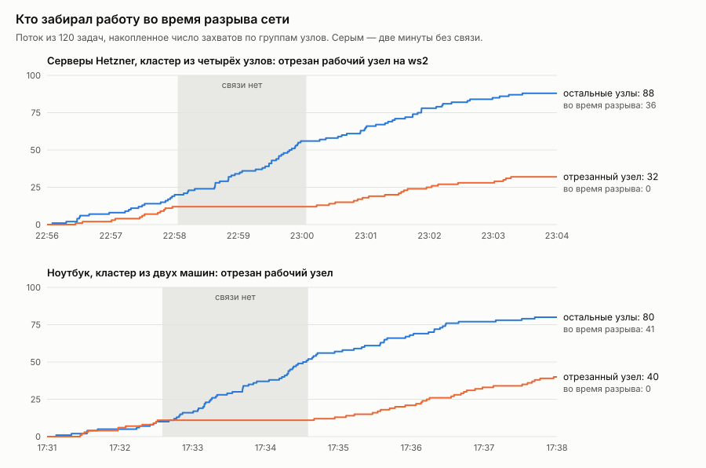


На этом стенде нашлись ещё две ошибки. Первая, серьёзная, сидела в прототипе, где агент хранил ключ подписи во временном каталоге пода. После перезапуска он приходил с новым ключом, молча заменял опубликованный, и его прежние квитанции переставали проверяться. TC-10 это поймал после перезапуска агентов. Теперь ключ хранится в Secret и переживает перезапуск и переезд агента, а если ключ всё-таки меняется, старый остаётся в списке прежних, выведенных из употребления ключей подложки. Прежние квитанции проверяются по нему, а квитанция с ключом, которого подложка никогда не публиковала, отвергается. После исправления мы перезапустили все 14 агентов, и ключи не изменились. Вторая ошибка нашлась в самом наборе тестов, где TC-14 ставил аннотацию по устаревшему чтению объекта и конфликтовал с пульсом агента. Теперь он повторяет запись при конфликте. Третья нашлась в упаковке: Helm-чарт вёз старую копию калибровки, без GPU, новых архитектур и CGRA, так что на кластере эти подложки были живы, но планировщик их не выбирал, а conformance этого не замечал. Теперь чарт берёт калибровку из `results/`, и тест падает, если копии расходятся; после исправления на кластере планировщик выбирает те же физики, что и на стенде.

Это то, что TC-13 и TC-14 проверяют аннотацией, но теперь на настоящем разрыве сети. Данные лежат в `results/partition-*` и `results/conformance-kuberoot-*.json`, а сценарии в `hack/kuberoot-local-multi.sh` и `hack/kuberoot-partition-*.sh`.

### 8.7. Среды, на которых мы проверяли

| Среда | Что на ней проверено |
|---|---|
| Ноутбук на Apple M4 (macOS, arm64) | Калибровка: 6405 записей по всем алгоритмам на всех физиках; модульные тесты (25 тестов: решатели против точного перебора, планировщик, квитанции, мандаты, круговой проход квитанции через API) |
| Control plane без узлов: kube-apiserver 1.37 и etcd из envtest, 14 агентов процессами | Сквозная работа без объектов Node; живой поток из 120 задач; conformance 17/17 и контрольный прогон 0/17 |
| Цифровой двойник на данных энергосистем DE, FR, PL, GB за первый и третий кварталы 2026 года | Сравнение семи политик, ценность прогноза, перенос данных, обучение при ошибочной модели, чувствительность к допущениям |
| Кластер kuberoot `edge`: собран из исходников под arm64, загружен в QEMU (HVF) на macOS, кластер из одного узла на Kubernetes 1.37.1; physis — подами из Helm-чарта пакета kubepkg, применённого kubectl | conformance 17/17; живой поток из 120 задач; проверка всех квитанций после него; найдена и исправлена ошибка точности чисел в квитанциях |
| Кластер kuberoot из двух машин: те же носители со статическими адресами кластерной сети, рабочий узел вошёл по JoinTicket; агенты 7 + 7 | conformance 17/17; поток из 120 задач с двухминутным разрывом сети рабочего узла; работа, взятая до разрыва и доложенная после него |
| Кластер kuberoot в тенанте кластера воркшопов Cozystack (KubeVirt на серверах Hetzner), amd64, собран в кластере: сначала три узла (ws1, ws3, ws3), затем четыре (плюс ws2) | conformance 17/17 на трёх и на четырёх узлах; потоки по 120 задач с двухминутным разрывом сети рабочего узла на ws3 (три узла) и на ws2 (четыре узла); работа, взятая до разрыва и доложенная после него (три узла); найдены и исправлены ошибка с ключом агента и гонка в TC-14 |
| Узел kuberoot без контейнеров (дистрибутив `physis`): виртуальная машина KubeVirt на сервере кластера воркшопов, physis как службы ОС, ни одного Node и пода | conformance 17/17 с 12 и с 20 подложками |
| Кластер kuberoot из четырёх узлов на текущем коде: 20 подложек, калибровка из `results/` | conformance 17/17; иерархия уровней подами; мост от DRA; передача по идентичности между узлами; MCP; разрыв сети в реальном времени |

---

## 9. Conformance для систем завтрашнего дня

Conformance Kubernetes отвечает на вопрос «реализует ли кластер API так же, как эталон». Наш набор задаёт другой вопрос: **ведёт ли себя система так, как требуют принципы**. Он работает как черный ящик, то есть обращается только к API, создаёт задачи в своём пространстве имён и судит по поведению, а не по устройству. Пройти его может любая реализация ресурсов `physis.kuberoot.dev/v1alpha1`, не только наша. Полная спецификация лежит в `docs/conformance.md`.

У тестов два уровня. **Core** обязателен. **Extended** ожидается от промышленных систем, и его можно пропустить с указанной причиной. Пропуск никогда не засчитывается как прохождение.

| Тест | Уровень | Принцип | Требование |
|---|---|---|---|
| TC-01 | Core | П3 | Каждая живая подложка указывает физику, зону, юрисдикцию оператора и модель, у каждого параметра которой есть происхождение |
| TC-02 | Core | П7 | Работа выполняется без объектов Node, а роли системы не дают доступа к узлам и подам |
| TC-03 | Core | П2, П4 | Запрос-результат планируется с прогнозом времени, энергии и интенсивности сети и выполняется в срок |
| TC-04 | Core | П4 | План показывает альтернативы, и ни одна не доминирована другой |
| TC-05 | Core | П5 | Недостижимый результат отклоняется с причинами и никогда не запускается |
| TC-06 | Core | П4 | Бюджет — жёсткий предел |
| TC-07 | Core | П11 | Разрешённые зоны и юрисдикции операторов — жёсткие ограничения |
| TC-08 | Core | П14 | Запрос пробного плана (dry run) возвращает план и ничего не запускает |
| TC-09 | Extended | П12 | Гибкая работа с длинным сроком ставится на минимум прогнозного углерода среди альтернатив |
| TC-10 | Core | П9 | У каждого результата есть подписанная квитанция; цепочка проверяется без доступа к системе; подделка обнаруживается |
| TC-11 | Core | П9 | Квитанции нельзя изменить |
| TC-12 | Core | П10 | Работа под мандатом с чужой подписью отклоняется; план выше порога ждёт одобрения человека и выполняется после него |
| TC-13 | Core | П7 | Работа, запланированная на замолчавшую подложку, возвращается в пул и выполняется на другой |
| TC-14 | Extended | П8 | Подложка, отрезанная от API после того, как забрала работу, доводит её и сообщает результат после восстановления связи |
| TC-15 | Core | П2, П3 | Один и тот же класс задач выполним более чем на одной физике |
| TC-16 | Core | П5 | Результат сообщает достигнутое качество, план — нижнюю границу уверенности и число наблюдений за ней |
| TC-17 | Core | П11 | Перенос данных оценивается по объектам `Link`; пути через запрещённые юрисдикции не используются |

Для TC-13 и TC-14 нужно сделать подложку недоступной. В реальной инсталляции это делается сетевой политикой, а эталонный набор использует переносимый приём, аннотацию `physis.kuberoot.dev/simulate-partition-until` на подложке. Получив её, агент прекращает весь обмен с API до указанного времени, но не прерывает начатую работу.

### Результаты

**physis проходит 17 из 17 на пяти стендах: на control plane без единого узла, на кластере kuberoot из одного узла, на кластере kuberoot из двух виртуальных машин на ноутбуке, на кластере kuberoot из четырёх узлов на трёх физических серверах и на узле kuberoot вовсе без контейнеров, где physis работает службами ОС.**

**Контрольный прогон** на том же control plane с теми же CRD, но без планировщика и агентов, то есть примерно на том, что даёт обычный Kubernetes, дал **0 из 17**. Контрольный прогон понадобился, чтобы проверить сами тесты. И он нашёл в них ошибку. TC-07 при отсутствии подложек ничего не проверял и засчитывался как пройденный. Теперь тест требует, чтобы было что проверять, то есть живые подложки хотя бы в двух зонах и двух юрисдикциях.

Сам набор тоже нашёл пять настоящих ошибок в прототипе, до того как мы о них знали. Во-первых, неизвестная цена хранилась как NaN, который не сериализуется в JSON, и планы просто не записывались. Во-вторых (TC-04), при неизвестной цене сравнение с NaN всегда ложно, и на границу компромиссов попадали доминируемые варианты. Правильно считать варианты по деньгам несравнимыми там, где цена неизвестна, и решать по остальным осям. В-третьих, терялась точность 64-битного зерна в квитанциях, о чём говорилось выше; это проявилось только на kuberoot. В-четвёртых, в агенте была гонка, при которой его пульс перезаписывал метаданные подложки по чуть устаревшему снимку и мог стереть аннотацию, которую туда только что поставил оператор. В-пятых, ключ подписи агента терялся при перезапуске (раздел 8.6). Нашлись и две ошибки в самих тестах. TC-14 сравнивал время с точностью до наносекунд, а аннотация передаёт его с точностью до секунды, и тест изредка ложно падал; кроме того, он ставил аннотацию по устаревшему чтению объекта и конфликтовал с пульсом агента. Ровно ради таких находок и нужен conformance.

---

## 10. Ограничения

Это часть результатов, а не приложение к ним. Полный список лежит в `docs/limitations.md`.

- **Шестнадцать из восемнадцати физик эмулируются.** Настоящие из них CPU и GPU (Apple M4 на стенде-ноутбуке). У GPU время измеряется, а мощность допущена, потому что Apple её не публикует. Выводы, которые держатся на одном допущенном числе, выводами считать нельзя; анализ чувствительности показывает, какие из них переживают диапазоны.
- **Один и тот же отжиг на CPU, цифровом, сверхпроводящем и обратимом устройствах даёт одинаковое качество по построению.** Реальное железо отличается точностью и шумом.
- **Эмуляция квантового процессора грубая**: фиксированные углы QAOA, до 20 кубитов, глобальная модель ошибок.
- **Живая культура — это эхо-сеть с допущенным шумом.**
- **Энергия CPU моделируется.** Измеренное процессорное время умножается на долю TDP одного ядра EPYC 9454P. Счётчики RAPL внутри подов кластера закрыты.
- **Калибровка шла на ноутбуке (Apple M4).** Скорость CPU в симуляторе взята у M4, а мощность у EPYC.
- **Интенсивность для Германии, Франции и Польши считаем мы сами**, без учёта импорта и экспорта, а лигнит приравнен к каменному углю, что занижает немецкую интенсивность.
- **Обучение в живом планировщике хранится в памяти** и теряется при перезапуске; в симуляторе оно сохраняется. В самом conformance-наборе отключение подложки в TC-13 и TC-14 имитируется аннотацией; настоящий разрыв сети проверен отдельными экспериментами на кластерах kuberoot из двух машин на ноутбуке и на серверах кластера воркшопов (раздел 8.6).
- **Пять архитектур, добавленных позже** (тензорный массив, вычисления в DRAM, dataflow, стохастические и гипермерные), работают на живых стендах и в conformance, но не в квартальных симуляциях, которые были прогнаны раньше. Их качество измерено, энергия смоделирована по пиковым скоростям; мощность dataflow-карты и энергия бит-операции стохастических и гипермерных схем заданы допущениями с диапазонами.
- **Задачи маленькие**, они измеряются джоулями, а не киловатт-часами. Важны отношения, а не абсолютные суммы.
- **Поток задач синтетический**, с явно указанными распределениями.
- **Стенды kuberoot — виртуальные машины**: в QEMU на ноутбуке (один узел и два) и в KubeVirt на серверах кластера воркшопов (четыре узла на трёх физических серверах), а не собственные стойки в ЦОДе. Отказоустойчивость самого kuberoot (несколько control plane, etcd) здесь не проверялась. Проверялось то, что physis ставится в kuberoot штатно и выполняет свой контракт.
- **Сеть завтрашнего дня сделана частично.** Связи как объекты с ценой, временем передачи и юрисдикцией пути работают и проверяются тестом TC-17; адресация подложек по идентичности с взаимной аутентификацией и перенос объектов между ними работают и проверены тестами и на стенде, но по умолчанию выключены. Почтовый ящик на объектах API для подложек за NAT, перенос данных как шаг плана, адресация по содержимому и выбор транспорта по контексту остаются дизайном; юрисдикция подложки заявлена, но не удостоверена. Значения энергии и пропускной способности связей взяты из оценки Аслана с экстраполяцией и из наших допущений.

---

## 11. Что дальше

physis — не продукт, а заявка, проверенная кодом. Часть того, что в первой версии статьи стояло в этом списке, уже сделана: настоящий GPU как подложка, адресация по идентичности, три уровня планирования, мост от DRA, ядро устройства вне Linux, интерфейс для агентов. Дальше напрашиваются такие шаги:

1. **Настоящее нестандартное железо.** Облачный квантовый процессор, FPGA-отжиг, нейроморфная плата, серверы с открытыми счётчиками энергии, а затем перекалибровка моделей по квитанциям на живых данных.
2. **Перенос данных как шаг плана**, с адресацией по содержимому и почтовым ящиком на объектах API для подложек за NAT.
3. **Иерархия без центрального etcd.** Сейчас уровни делят одно хранилище, а следующим шагом станут свои хранилища у площадок и согласование через квитанции.
4. **Стандарт.** Обсудить ресурсы, профиль conformance и атрибуты стоимости в DRA с сообществом, так, как когда-то обсуждали CNI и CSI (подробнее в разделах 12 и 13).

Всё открыто: код, данные (через скрипты загрузки), тесты, модели и их источники. Если вам близка идея инфраструктуры, которая целится в завтра, а не тащит вчерашнее, присоединяйтесь с подложкой, с критикой модели или с тестом, который наш прототип не пройдёт.


---

## 12. Как развивать Kubernetes, чтобы он подошёл и вчерашнему, и завтрашнему миру

Из прототипа следует простой вывод, что переписывать Kubernetes не нужно, а нужно провести в нём другую границу между ядром и тем, что к нему подключается. Сегодня граница проходит так, будто машина с Linux и контейнеры входят в сам API. Объект Node, kubelet, Pod и сеть подов вшиты в модель, а всё необычное приходится выдавать за них. Завтра машина с Linux станет одной из подложек, и ядро не должно о ней знать больше, чем о квантовом процессоре.

**Что оставить в ядре.** API-сервер с хранилищем, watch и оптимистичной блокировкой, CRD, RBAC, admission и аудит, модель «желаемое состояние — контроллеры». Это и есть настоящий вклад Kubernetes, и прототип опирается только на него. На стенде без единого узла physis проходит все 17 тестов. Ядро стоит стабилизировать как отдельный продукт, то есть плоскость управления без узлов, к которой давно идёт kcp, с собственным профилем conformance, который не требует ни Node, ни Pod.

**Что сделать подключаемым.** Каждое место, где сегодня зашит конкретный мир, становится контрактом с несколькими реализациями, так же, как когда-то CNI, CSI и CRI вынесли сеть, хранилище и среду исполнения.

- *Исполнитель.* kubelet превращается в одну из реализаций контракта агента подложки: описать себя моделью с происхождением параметров, слать пульс, забирать работу, подписывать результат, доставлять отчёт после обрыва. Контейнерный узел реализует его через поды, квантовый процессор — через свой управляющий стек, микроконтроллер — через ядро устройства на последовательном порту. Объект Node остаётся для тех, кому он нужен, но перестаёт быть обязательным для любой работы.
- *Описание ресурсов.* DRA уже описывает устройства структурированными атрибутами, но ему не хватает стандартных атрибутов стоимости (скорости, энергии на операцию, мощности, подготовки, окон калибровки) с указанием происхождения. Это небольшое расширение, которое можно предложить в виде KEP, и мост из прототипа показывает, как оно ляжет на планирование.
- *Планирование.* Рядом с kube-scheduler, который раскладывает поды по узлам, нужен планировщик результатов как отдельный подключаемый компонент, который работает с задачами, описанными как результат, и с целями по энергии, углероду, деньгам и юрисдикции. Scheduling framework здесь не поможет, потому что он отвечает на вопрос «какой узел», а теперь вопрос звучит как «какой алгоритм, на какой физике, где и когда».
- *Сеть.* kube-proxy и CNI становятся деталью одной площадки. Между площадками контрактом становятся связи как объекты с ценой и юрисдикцией пути и адресация по идентичности, как в разделе 6.
- *Учёт и доверие.* Подписанные квитанции становятся стандартным API рядом с Events, неизменяемым и проверяемым без доступа к кластеру. Квоты получают измерения в джоулях, граммах CO₂ и деньгах, а мандаты расширяют RBAC делегированием бюджета от человека агенту.

**Как не сломать старый мир.** Pod, Deployment и Job остаются. Для старой работы задача-результат может просто разворачиваться в под на подложке «процессы Linux», поэтому существующие чарты, операторы и GitOps продолжают работать. Новое появляется рядом, как CRD и отдельные компоненты, и вытесняет старое только там, где оно лучше. Так шёл прототип, и ни один шаг не потребовал менять апстрим.

**В каком порядке.** Сначала идёт то, что ничего не ломает, то есть стандартные атрибуты стоимости в DRA и учёт энергии в метриках и квотах. Затем контракт агента подложки как отдельная спецификация и планировщик результатов как внешний компонент. Затем профиль conformance «завтрашнего дня» рядом с нынешним, чтобы реализации могли честно сказать, что они умеют. И только потом можно сделать Node и Pod в ядре необязательными, когда для этого будут живые реализации, а не только прототип.

## 13. Cozystack как платформа для такого слоя

Cozystack — открытая платформа в CNCF, на которой провайдеры строят своё облако: Kubernetes, виртуальные машины на KubeVirt, управляемые базы и кластеры для тенантов. Ничего из описанного в этой статье в нём сейчас нет. Но по устройству он ближе к нужной форме, чем голый Kubernetes, потому что у него уже есть тенанты как граница ответственности, каталог сервисов, провайдеры на разных площадках и поддержка GPU. Чтобы стать основой слоя завтрашнего дня, ему нужно пройти несколько шагов, и каждый имеет смысл сам по себе.

Первый шаг делает тенант держателем мандатов и бюджетов. Сегодня тенант получает квоты на процессоры и память. Ему нужны бюджеты в джоулях, граммах CO₂ и деньгах, зоны и юрисдикции, а людям внутри тенанта — возможность делегировать часть бюджета агентам с уровнем автономии и порогом, выше которого нужна подпись человека.

Второй шаг добавляет каталог подложек рядом с каталогом сервисов. Провайдер на Cozystack публикует не только виртуальные машины и кластеры, но и подложки (GPU, ускорители, позже нестандартные физики) с моделью стоимости, происхождением параметров и юрисдикцией оператора. Естественной точкой входа служит мост от DRA из этого прототипа. Когда GPU, которые Cozystack отдаёт тенантам, будут описаны драйвером DRA (у NVIDIA GPU Operator такой режим уже есть), они станут подложками, как только их возьмёт на обслуживание агент, умеющий запускать на них работу.

Третий шаг даёт учёт, которому можно верить. Счётчики энергии на площадках, интенсивность выбросов энергосистемы и подписанные квитанции превращают «сколько это стоило» из оценки в проверяемую запись, а биллинг по джоулям и граммам — в продукт, который можно показать регулятору.

Четвёртый шаг превращает федерацию в рынок. Много провайдеров на Cozystack в разных странах, связанных объектами связей с ценой и юрисдикцией пути, и составляют «облако как рынок подложек» из раздела 6. Суверенитет здесь становится ограничением планирования, а не обещанием в договоре, и задача уходит только туда, куда её пускают мандат и юрисдикция данных.

Пятый шаг даёт интерфейс для агентов на уровне платформы (MCP-сервер, пробные планы, идемпотентность, коды отказов и защита от частых вызовов), чтобы агенты тенантов работали с платформой напрямую, не притворяясь людьми в веб-консоли.

Шестой шаг касается узлов. Для классической работы Talos остаётся правильным выбором, потому что он зрелый, а KubeVirt, на котором держатся виртуальные машины Cozystack, только что получил статус graduated в CNCF. Переносить Cozystack целиком на kuberoot сейчас смысла нет. Но для специализированных подложек нужны узлы без контейнеров, где агент работает службой самой ОС. Kuberoot здесь служит лабораторией, где это проверяется от ядра до API, а то, что докажет ценность, переносится в стандарт компонентами.

Последний шаг касается conformance. Нейтральная открытая платформа подходит для эталонной реализации профиля «завтрашнего дня», причём не для того, чтобы владеть стандартом, а для того, чтобы у стандарта была живая реализация, которую любой провайдер может развернуть и проверить. Компании вроде Ænix в такой модели становятся провайдерами продуктов поверх платформы и ускорителем для других провайдеров. Начать можно с малого и уже сейчас, потому что у physis есть Helm-чарт и его можно поставить в Kubernetes-кластер тенанта Cozystack, как любое другое приложение.

## Литература и данные

Ключи в квадратных скобках в тексте ведут сюда. Где цифра взята из вторичного источника, это сказано. Полный список с пометками о том, что мы проверяли сами, — в `docs/references.md` репозитория.

### Physics and devices

- **legallo2023** — M. Le Gallo et al., "A 64-core mixed-signal in-memory compute chip based on phase-change memory for deep neural network inference", *Nature Electronics* (2023), doi:10.1038/s41928-023-01010-1. 63.1 TOPS at 9.76 TOPS/W for 8-bit input/output MVM; effective MVM precision 3–4 bits. HERMES, 63.1 TOPS and 9.76 TOPS/W are in the abstract; the 3–4-bit precision is in the body text (arXiv:2212.02872); see also HPCwire's summary: https://www.hpcwire.com/off-the-wire/ibm-develops-a-new-64-core-mixed-signal-in-memory-computing-chip/
- **ambrogio2023** — S. Ambrogio et al., "An analog-AI chip for energy-efficient speech recognition and transcription", *Nature* 620 (2023). Up to 12.4 TOPS/W. https://www.nature.com/articles/s41586-023-06337-5
- **horowitz2014** — M. Horowitz, "Computing's energy problem (and what we can do about it)", ISSCC 2014, doi:10.1109/ISSCC.2014.6757323. Energy per operation at 45 nm (8-bit multiply ≈ 0.2 pJ, 8-bit add ≈ 0.03 pJ). Copy: https://www.Gwern.net/doc/cs/hardware/2014-horowitz-2.pdf (we did not re-read the table in this work; the values are the widely cited ones).
- **jouppi2017tpu** — N. P. Jouppi et al., "In-Datacenter Performance Analysis of a Tensor Processing Unit", ISCA 2017 (arXiv:1704.04760): "a 65,536 8-bit MAC matrix multiply unit that offers a peak throughput of 92 TeraOps/second"; TOPS/Watt "about 30X - 80X higher" than contemporary GPU or CPU; 75 W TDP, 40 W busy. https://arxiv.org/abs/1704.04760
- **jouppi2023tpuv4** — N. P. Jouppi et al., "TPU v4: An Optically Reconfigurable Supercomputer", ISCA 2023 (arXiv:2304.01433): "outperforms TPU v3 by 2.1x and improves performance/Watt by 2.7x". https://arxiv.org/abs/2304.01433
- **abts2020tsp** — D. Abts et al., "Think Fast: A Tensor Streaming Processor for Accelerating Deep Learning Workloads", ISCA 2020, doi:10.1109/ISCA45697.2020.00023 (abstract): no "reactive elements in the hardware (e.g. arbiters, and caches)"; slides (ISC 2020): "~750 Tops (Int8Acc32) peak", "220 MiBytes of globally shared SRAM". Power is not given in these sources. https://mlhardware.github.io/2020/groq.pdf
- **cerebras2024wse3** — Cerebras, "Cerebras announces third generation wafer scale engine", 13 March 2024: "900,000 AI optimized compute cores", "44GB on-chip SRAM", "125 petaflops of peak AI performance". https://www.cerebras.ai/press-release/cerebras-announces-third-generation-wafer-scale-engine
- **prabhakar2024sn40l** — R. Prabhakar et al., "SambaNova SN40L: Scaling the AI Memory Wall with Dataflow and Composition of Experts", arXiv:2405.07518: 1040 compute and 1040 memory units, 520 MiB on-chip SRAM, operator fusion on chip. https://arxiv.org/abs/2405.07518
- **kwon2021fimdram** — Y.-C. Kwon et al., "A 20nm 6GB Function-In-Memory DRAM, Based on HBM2 with a 1.2TFLOPS Programmable Computing Unit Using Bank-Level Parallelism", ISSCC 2021, doi:10.1109/ISSCC42613.2021.9365862 (abstract).
- **lee2021pim** — S. Lee et al., "Hardware Architecture and Software Stack for PIM Based on Commercial DRAM Technology", ISCA 2021, doi:10.1109/ISCA52012.2021.00013 (abstract): "reduces the energy per bit transfer by 3.5×".
- **gomezluna2022upmem** — J. Gómez-Luna et al., "Benchmarking a New Paradigm: Experimental Analysis and Characterization of a Real Processing-in-Memory System", IEEE Access 10 (2022), doi:10.1109/ACCESS.2022.3174101 (arXiv:2105.03814): the UPMEM systems "outperform a modern CPU (by 93.0× and 27.9×, on average, respectively) for 13 of the PrIM benchmarks". https://arxiv.org/abs/2105.03814
- **micikevicius2022fp8** — P. Micikevicius et al., "FP8 Formats for Deep Learning", arXiv:2209.05433: E4M3 and E5M2; "effectively matching the result quality achieved by 16-bit training sessions" up to 175B-parameter models. https://arxiv.org/abs/2209.05433
- **rouhani2023mx** — B. D. Rouhani et al., "Microscaling Data Formats for Deep Learning", arXiv:2310.10537: blocks of 32 with a shared E8M0 scale; training with 4-bit MX weights, "incurring only a minor accuracy drop". https://arxiv.org/abs/2310.10537
- **alaghi2013survey** — A. Alaghi, J. P. Hayes, "Survey of Stochastic Computing", ACM TECS 12(2s), 2013: multiplication by "a single AND gate"; "A stochastic number p̂ of length n has m = log2 n bits of precision". https://homes.cs.washington.edu/~armin/ACM_TECS_2013.pdf
- **kanerva2009hdc** — P. Kanerva, "Hyperdimensional Computing", Cognitive Computation 1 (2009), doi:10.1007/s12559-009-9009-8: "When bits fail, the information degrades in relation to the number of failing bits irrespective of their position". https://cs.uwaterloo.ca/~jhoey/teaching/cogsci600/papers/Kanerva09.pdf
- **karunaratne2020inmemory** — G. Karunaratne et al., "In-memory hyperdimensional computing", Nature Electronics 3 (2020), doi:10.1038/s41928-020-0410-3 (arXiv:1906.01548): "> 6× end-to-end reductions in energy compared with a dedicated digital CMOS implementation". https://arxiv.org/abs/1906.01548
- **podobas2020cgra** — A. Podobas, K. Sano, S. Matsuoka, "A Survey on Coarse-Grained Reconfigurable Architectures From a Performance Perspective", IEEE Access 8 (2020), doi:10.1109/ACCESS.2020.3012084 (arXiv:2004.04509): "a majority of CGRAs can execute more operations ... per unit power" than GPUs; "Some architectures, such as the Plasticine, can be up to two orders of magnitude more power-efficient". https://arxiv.org/abs/2004.04509
- **singh2024** — N. S. Singh et al., CMOS plus stochastic magnetic tunnel junctions for probabilistic computing (arXiv:2304.05949). The paper does not measure sMTJ p-bit energy; it repeats an earlier projection of about 2 fJ per random bit (its Ref. [28]), and reports 145–293 fJ for CMOS p-bits. https://arxiv.org/html/2304.05949v3
- **aadit2022** — N. A. Aadit et al., "Massively parallel probabilistic computing with sparse Ising machines", *Nature Electronics* (2022). Background for p-bit throughput; no figure is taken from it.
- **tatsumura2019** — K. Tatsumura, A. Dixon, H. Goto, "FPGA-Based Simulated Bifurcation Machine", FPL 2019: 2000-node all-to-all MAX-CUT 14× faster than the CIM and 124× faster than optimised simulated annealing (paper, doi:10.1109/FPL.2019.00019). Slides: https://fpl2019.bsc.es/sites/default/files/uploaded/A12.FPL2019-slides-FPGABasedSimulatedBifurcation.pdf ; algorithm: H. Goto, K. Tatsumura, A. Dixon, *Science Advances* (2019), doi:10.1126/sciadv.aav2372.
- **cim2018** — NTT, coherent Ising machine with up to 1936 coupled DOPOs, *Nature Communications* 9 (2018). https://ideas.repec.org/a/nat/natcom/v9y2018i1d10.1038_s41467-018-07328-1.html
- **cim2026** — Optical Ising machine based on polarization symmetry breaking in a driven Kerr resonator (Auckland/Dijon/Strathclyde), *Nature Communications* (2026). https://thequantuminsider.com/2026/03/24/new-zealand-researchers-report-advance-in-optical-ising-machine-for-hybrid-quantum-optimization/
- **arute2019supp** — F. Arute et al., supplementary information for "Quantum supremacy using a programmable superconducting processor" (arXiv:1910.11333): total worst-case apparatus power about 26 kW (dilution refrigerator about 10 kW plus chilled water, about 3 kW electronics). https://arxiv.org/pdf/1910.11333
- **cryo4k** — Development of a 4 K–10 K Collins-type cryocooler for space, SPIE 5904 (2005), abstract: "machines based on the conventional Collins or Brayton cycles routinely operate with input powers of about 740 Watts per Watt of refrigeration at 4K"; small coolers of about 1 W at 4 K "typically require 5 kW–7.5 kW per Watt". https://opticalengineering.spiedigitallibrary.org/conference-proceedings-of-spie/5904/59040X/Development-of-a-4K-10K-Collins-type-cryocooler-for-space/10.1117/12.626151.full
- **imec-sfq** — imec superconducting digital computing: "How to Put a Data Center in a Shoebox", IEEE Spectrum. https://spectrum.ieee.org/superconducting-computer
- **loihi** — M. Davies et al., "Loihi: A Neuromorphic Manycore Processor with On-Chip Learning", *IEEE Micro* 38(1), 2018. Energy per synaptic operation as reported by later surveys: 20–25 pJ (we did not find the figure in the paper's abstract). https://arxiv.org/pdf/2509.23896
- **halapoint** — Sandia, Hala Point (1152 Loihi 2 chips, 1.15 billion neurons). https://www.sandia.gov/news/publications/hpc-annual-reports/article/advancing-neuromorphic-computing-at-the-neural-exploration-and-research-lab/
- **photonic2024** — Minimalistic photonic matrix processor: 0.27 pJ/MAC laser energy at 10 mW and 36.7 GBaud (arXiv:2403.04216). https://arxiv.org/pdf/2403.04216
- **lightmatter** — Lightmatter photonic interconnect roadmap. https://convergedigest.com/ai-infrastructure-summit-lightmatters-photonic-roadmap/?amp=1
- **cl1power** — Cortical Labs CL1 (heise online, 12 March 2025): human neurons grown from stem cells on a chip, about $35,000 per device, about 20 W, cells live "up to six months". We model 30 W of life support (range 20–100 W); a higher figure only makes the culture less attractive, which changes no result. https://heise.de/-10312614
- **finalspark** — FinalSpark Neuroplatform; organoid lifetime about 100 days. https://www.tomshardware.com/pc-components/cpus/worlds-first-bioprocessor-uses-16-human-brain-organoids-for-a-million-times-less-power-consumption-than-a-digital-chip
- **vaire** — Vaire Computing adiabatic reversible test chip "Ice River": tested in August 2025, it "drew around 30 percent less energy than a regular chip performing the same computation" (Science News). https://www.sciencenews.org/article/computer-chip-reuses-energy ; https://www.techradar.com/pro/more-like-a-pendulum-than-a-hammer-the-ai-chip-that-can-reuse-its-own-energy-reaches-proof-of-concept-stage-but-i-dont-think-it-will-be-enough-to-convince-hyperscalers-to-invest
- **extropic** — Extropic thermodynamic computing. https://extropic.ai/writing/from-one-to-one-billion
- **mcmahon** — L. G. Wright et al., deep physical neural networks trained with backpropagation, *Nature* 601 (2022); training review *Nature* 645 (2025). https://mcmahon.aep.cornell.edu/aspen/2024/slides/Wright.pdf
- **metamaterial2026** — Mechanical metamaterials with reprogrammable sequential deformation for analog-to-digital encoding and computing, *Advanced Materials* (2026). https://advanced.onlinelibrary.wiley.com/doi/10.1002/adma.74376
- **ackley** — D. Ackley, robust-first computing and the Movable Feast Machine. https://highscalability.com/pursue-robust-indefinite-scalability-with-the-movable-feast/ ; T2 Tiles: https://creativegood.com/blog/21/ackley-and-tiles.html
- **landauer** — the Landauer limit kT ln 2 per erased bit (textbook result).
- **pcss-hybrid** — Hybrid classical-quantum supercomputing: multi-user, multi-QPU and multi-GPU environment at PCSS under Slurm (arXiv:2508.16297). https://arxiv.org/pdf/2508.16297
- **hpc-qc-sched** — Assessing the elephant in the room in scheduling for current hybrid HPC-QC clusters (arXiv:2504.10520). https://arxiv.org/pdf/2504.10520
- **dna2026** — Biomemory DNA storage in datacenters (Blocks & Files, 2026). https://www.blocksandfiles.com/architecture/2026/03/06/french-dna-coming-to-a-datacenter-near-you-soon/4093753
- **suncatcher** — Google Project Suncatcher: two prototype TPU satellites with Planet Labs by early 2027 (Interesting Engineering); Starcloud satellite with an NVIDIA GPU. https://interestingengineering.com/innovation/google-project-suncatcher-space-ai ; https://www.fierce-network.com/cloud/space-data-centers-starcloud-spacex-and-project-suncatcher-explained

### Systems and software

- **borg** — A. Verma et al., "Large-scale cluster management at Google with Borg", EuroSys 2015.
- **k8s-large** — Kubernetes, "Considerations for large clusters": designed for at most 110 pods per node, 5,000 nodes, 150,000 pods and 300,000 containers. https://kubernetes.io/docs/setup/best-practices/cluster-large/
- **k8s-net** — Kubernetes cluster networking model: every pod has its own IP, pods communicate without NAT. https://kubernetes.io/docs/concepts/cluster-administration/networking/
- **nftables** — KEP-3866, "Add an nftables-based kube-proxy backend": alpha 1.29, beta 1.31, stable 1.33; iptables remains the default. https://www.k8s.dev/resources/keps/3866/ ; "NFTables mode for kube-proxy", Kubernetes blog, 2025. https://kubernetes.io/blog/2025/02/28/nftables-kube-proxy/
- **kep5495** — KEP-5495: deprecate ipvs mode in kube-proxy (deprecated in 1.35). https://www.k8s.dev/resources/keps/5495/
- **dra** — "Kubernetes v1.34: DRA has graduated to GA", Kubernetes blog, 2025. https://kubernetes.io/blog/2025/09/01/kubernetes-v1-34-dra-updates/ ; documentation: https://kubernetes.io/docs/concepts/scheduling-eviction/dynamic-resource-allocation/
- **homa** — J. Ousterhout, "It's Time to Replace TCP in the Datacenter", arXiv:2210.00714. https://arxiv.org/abs/2210.00714
- **rfc9171** — S. Burleigh, K. Fall, E. Birrane, "Bundle Protocol Version 7", RFC 9171, 2022. https://www.rfc-editor.org/rfc/rfc9171
- **dbos** — "DBOS: A DBMS-oriented Operating System", PVLDB 15. https://mail.vldb.org/pvldb/volumes/15/paper/DBOS%3A%20A%20DBMS-oriented%20Operating%20System
- **hydro** — J. Hellerstein, Hydro. https://jhellerstein.github.io/blog/hello-aws
- **calm** — J. Hellerstein, P. Alvaro, "Keeping CALM: When Distributed Consistency Is Easy", *CACM* 2020.
- **adrs** — "Barbarians at the Gate: How AI is Upending Systems Research", arXiv:2510.06189. https://arxiv.org/abs/2510.06189v1
- **demoura2026** — L. de Moura, "Lean 4: A Unified Platform for Programming and Verification", NFM 2026. https://leodemoura.github.io/static/nfm2026/
- **skypilot** — "Going Beyond Hyperscaler Clouds in the Sky Ecosystem with SkyPilot". https://www2.eecs.berkeley.edu/Pubs/TechRpts/2023/EECS-2023-179.html
- **localfirst** — M. Kleppmann, local-first software (SE Radio 716, 2026). https://se-radio.net/2026/04/se-radio-716-martin-kleppmann-local-first-software/
- **malleable** — Ink & Switch, "Malleable Software", 2025. https://www.inkandswitch.com/essay/malleable-software/
- **microvm2026** — "Your Container Is Not a Sandbox: The State of MicroVM Isolation in 2026". https://emirb.github.io/blog/microvm-2026/
- **oxide** — Oxide Computer: a rack designed as one integrated platform (compute, storage, networking, software). https://oxide.computer/
- **kcp** — kcp: "Kubernetes-like control planes for form-factors and use-cases beyond Kubernetes and container workloads"; it serves Kubernetes-style APIs with no nodes. https://github.com/kcp-dev/kcp
- **virtual-kubelet** — Virtual Kubelet: a kubelet implementation that "masquerades as a kubelet for the purposes of connecting Kubernetes to other APIs" (ACI, AWS Fargate and others). https://github.com/virtual-kubelet/virtual-kubelet
- **talos** — Talos Linux: an immutable, API-managed OS that runs only Kubernetes. https://www.talos.dev/
- **hubris** — Oxide Computer, Hubris: a small open-source operating system for deeply-embedded systems (the microcontrollers of Oxide's racks). https://hubris.oxide.computer/
- **rfc9162** — B. Laurie, E. Messeri, R. Stradling, "Certificate Transparency Version 2.0", RFC 9162, 2021. https://www.rfc-editor.org/rfc/rfc9162
- **rekor** — Sigstore Rekor, an append-only transparency log for signed software artefacts. https://docs.sigstore.dev/logging/overview/
- **mlir** — C. Lattner et al., "MLIR: Scaling Compiler Infrastructure for Domain Specific Computation", CGO 2021; preprint "MLIR: A Compiler Infrastructure for the End of Moore's Law", arXiv:2002.11054. https://arxiv.org/abs/2002.11054
- **jevons** — W. S. Jevons, *The Coal Question*, 1865; on the rebound effect see B. Alcott, "Jevons' paradox", *Ecological Economics* 54 (2005), doi:10.1016/j.ecolecon.2005.03.020. Checked: title, author, journal and volume via Crossref.
- **cxl-dc** — Panmnesia and Meta, CXL fabric spanning AI datacentres. https://www.hpcwire.com/off-the-wire/panmnesia-and-meta-outline-cxl-fabric-spanning-entire-ai-data-centers/ ; "One-chip-like datacenter design enabled by CXL-based scale-up fabrics", *Nature Reviews Electrical Engineering* (2026). https://www.nature.com/articles/s44287-026-00315-5
- **ocp2026** — "OCP 2026: Agentic AI Pushes the Data Center from Chip to Grid". https://www.datacenterfrontier.com/hyperscale/article/55411534/ocp-2026-agentic-ai-pushes-the-data-center-from-chip-to-grid
- **fhe2026** — Niobium, "The Fog": encrypted cloud for FHE workloads, private beta April 2026, running on the mistic Core FPGA accelerator; Niobium's FHE ASIC is in development. https://www.darkreading.com/endpoint-security/niobium-introduces-the-fog ; https://siliconangle.com/?p=737132

### Economics and energy

- **capex2026** — Yield Theory, "Hyperscaler Capex 2026: $720B to $740B Guidance by Company" (updated 5 November 2026). https://www.yieldtheory.app/research/hyperscaler-ai-capex-tracker-2026
- **gartner2026** — Gartner, "Gartner Forecasts Worldwide IT Spending to Grow 14.2% in 2026, Totaling $6.37 Trillion", 27 July 2026. https://www.gartner.com/en/newsroom/press-releases/2026-07-27-gartner-forecasts-worldwide-it-spending-to-grow-14-point-2-percent-in-2026-totaling-6-point-37-trillion ; the Gartner page refuses automated fetching, the release is checked through TelecomTV: https://www.telecomtv.com/content/digital-platforms-services/gartner-forecasts-worldwide-it-spending-to-grow-14-2-in-2026-totalling-6-37tn-55964/
- **ai-debt** — "Morgan Stanley estimates global AI debt issuance to double to $570 billion in 2026" (Reuters via newkerala, 10 June 2026): "global debt issuance for AI companies to top $500 billion in 2026". https://www.newkerala.com/news/a/morgan-stanley-estimates-global-ai-debt-issuance-double-248.htm
- **ap2-fido** — "FIDO Alliance to start work on interoperable standards for agentic commerce", Biometric Update, April 2026: work drawing on initial contributions from Google (AP2) and Mastercard. https://www.biometricupdate.com/202604/fido-alliance-to-start-work-on-interoperable-standards-for-agentic-commerce
- **boe-fsr-2026** — Bank of England, Financial Stability Report, July 2026, section 2.3: "chips have short and uncertain lifecycles … debt maturities aligned with the asset life of AI chips would imply shorter tenors than are typically preferred by most credit investors". https://www.bankofengland.co.uk/-/media/boe/files/financial-stability-report/2026/financial-stability-report-july-2026.pdf
- **woodmac-transformers** — Wood Mackenzie, "Supply shortages and an inflexible market give rise to high power transformer lead times": lead times from about 50 weeks in 2021 to 120 weeks on average in 2024. https://www.woodmac.com/news/opinion/supply-shortages-and-an-inflexible-market-give-rise-to-high-power-transformer-lead-times/
- **scripps-o2** — Scripps O2 Program: "The observed downward trend amounts to 19 'per meg' per year", mostly from fossil-fuel burning. https://scrippso2.ucsd.edu
- **primavera2021** — B. A. Primavera, J. M. Shainline, "Considerations for neuromorphic supercomputing in semiconducting and superconducting optoelectronic hardware", arXiv:2106.14803: Carnot limit 74 W/W at 4 K from 300 K; "State-of-the-art systems have reached specific powers below 400 W/W". https://arxiv.org/abs/2106.14803
- **stockholm-data-parks** — Stockholm Data Parks: heat recovery from data centres paid for by the district heating network. https://stockholmdataparks.com/
- **spolsky** — J. Spolsky, "Strategy Letter V" (commoditize your complements), 2002. https://www.joelonsoftware.com/2002/06/12/strategy-letter-v/
- **rfc6962** — B. Laurie, A. Langley, E. Kasper, "Certificate Transparency", RFC 6962, 2013 (the version deployed logs implement). https://www.rfc-editor.org/rfc/rfc6962
- **epoch-prices** — Epoch AI, LLM inference price trends. https://epoch.ai/blog/llm-inference-price-trends
- **compute-futures** — FIA, "What are compute futures". https://www.fia.org/fia/articles/explainer-what-are-compute-futures-and-how-do-they-work
- **x402** — Linux Foundation, "Linux Foundation is Launching the x402 Foundation and Welcoming the Contribution of the x402 Protocol", 2 April 2026. https://www.linuxfoundation.org/press/linux-foundation-is-launching-the-x402-foundation-and-welcoming-the-contribution-of-the-x402-protocol
- **outcome-pricing** — EQT Ventures on outcome-based pricing. https://stories.eqtventures.com/articles/monetising-the-agentic-workforce-is-outcome-based-pricing-the-answer
- **data-act** — Regulation (EU) 2023/2854 (Data Act), Article 29: "From 12 January 2027, providers of data processing services shall not impose any switching charges on the customer for the switching process." https://eur-lex.europa.eu/legal-content/EN/TXT/HTML/?uri=CELEX:32023R2854
- **power2026** — Grid interconnection and data centre power. https://www.softwareseni.com/the-broken-power-grid-infrastructure-bottlenecks-driving-the-nuclear-push-for-ai-data-centres/
- **aslan2018** — J. Aslan, K. Mayers, J. Koomey, C. France, "Electricity Intensity of Internet Data Transmission: Untangling the Estimates", *Journal of Industrial Ecology* 22(4), 2018, doi:10.1111/jiec.12630: 0.06 kWh/GB in 2015, halving about every two years. We extrapolate to 2026 (0.06 / 2^5.5 kWh/GB); the extrapolation is ours.
- **ipcc2014** — IPCC AR5 WGIII Annex III, Table A.III.2, life-cycle emission medians (gCO2e/kWh): coal 820, gas 490, biomass 230, solar PV utility 48, geothermal 38, hydro 24, nuclear 12, wind onshore 11 (the code uses 11.5, a transcription slip kept so that the published results reproduce; at most 0.5 g/kWh), wind offshore 12. Checked against the primary: https://www.ipcc.ch/site/assets/uploads/2018/02/ipcc_wg3_ar5_annex-iii.pdf ; NREL harmonisation for comparison: https://www.nrel.gov/docs/fy21osti/80580.pdf

### Foresight

- **iftf2036** — Institute for the Future, Ten-Year Forecast 2036 "What We Choose Next" (October 2026). https://www.iftf.org/projects/iftf-ten-year-forecast-2036-tyf/
- **iftf2025** — IFTF Ten-Year Forecast 2025–2035 "Strategy in the Age of Chaos". https://www.iftf.org/events/iftf-ten-year-forecast-2025-2035-sanctuaries-of-social-imagination/ ; perspectives: https://www.iftf.org/projects/iftf-ten-year-forecast-urgent-futures-perspectives/
- **ftsg2026** — Future Today Strategy Group, Convergence Outlook 2026 (Amy Webb, SXSW 2026), as reported by Meio & Mensagem and FTSG's own summaries; the full report is behind a form. https://sxsw.md/news/2026-03-16-amy-webb-end-of-trend-reports ; https://fortune.com/brandstudio/future-today-strategy-group/the-5-convergences-that-will-redefine-business
- **abi-physical** — ABI Research, "Physical AI at Scale: Why Robotics Needs a New Data Infrastructure". https://www.abiresearch.com/blog/physical-ai-at-scale-why-robotics-needs-a-new-data-infrastructure

### Data and benchmarks

- **gset-best** — Gset best-known MaxCut values: G1 = 11624, G2 = 11620, G22 = 13359, confirmed in two independent sources (e.g. arXiv:2606.03917 and the Tabu-search comparison table of Ma and Hao 2017 as cited). Instances: https://web.stanford.edu/~yyye/yyye/Gset/
- **optdigits** — E. Alpaydin, C. Kaynak, "Optical Recognition of Handwritten Digits", UCI Machine Learning Repository (CC BY 4.0). https://archive.ics.uci.edu/dataset/80/optical+recognition+of+handwritten+digits ; files: https://archive.ics.uci.edu/ml/machine-learning-databases/optdigits/optdigits.tra
- **energy-charts** — Fraunhofer ISE, Energy-Charts API (public net generation; day-ahead prices CC BY 4.0 from Bundesnetzagentur | SMARD.de). https://api.energy-charts.info/
- **uk-ci** — National Energy System Operator, Carbon Intensity API (forecast and actual, CC BY 4.0). https://carbonintensity.org.uk/
- **amd-9454p** — AMD EPYC 9454P: 48 cores, 290 W default TDP, configurable 240–300 W (reseller specification sheets; AMD lists the same). https://www.scan.co.uk/products/amd-epyc-9454p-s-sp5-5nm-zen-4-48-core-96-thread-275ghz-38ghz-turbo-256mb-290w-cpu-oem


